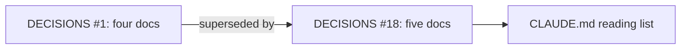
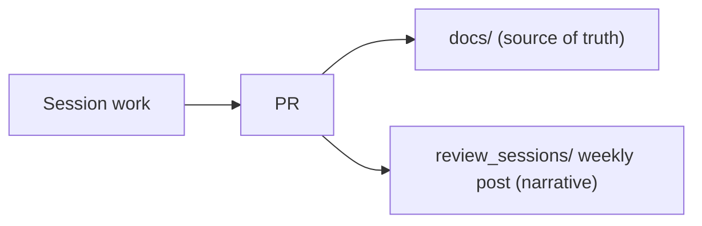
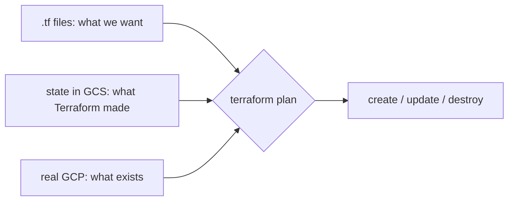
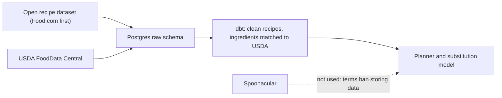
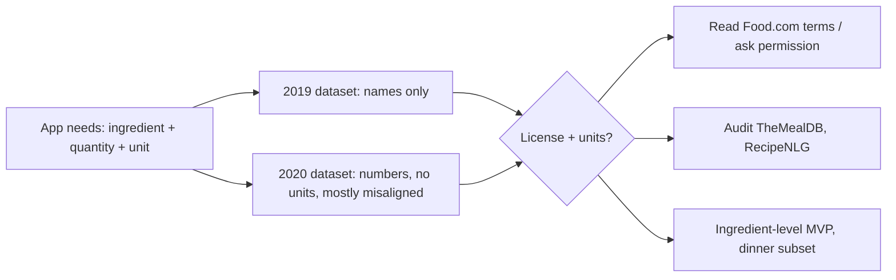
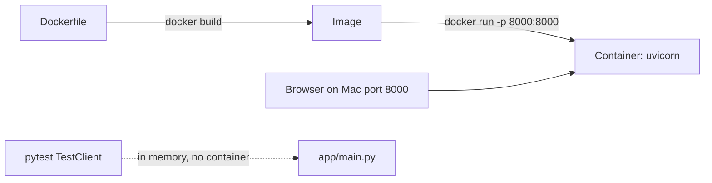

# Week of 10.07 to 10.14: Docs workflow (Andrew)

## Summary
This week set up how we document the project (CONCEPTS.md joined the source-of-truth docs, and we started these weekly review posts), chose GCP with a Terraform scaffold under `infra/`, audited the Food.com recipe datasets, which turned out to lack ingredient units, and wrote the first app code: a FastAPI `/health` endpoint with a Dockerfile and a test.

## PRs this week
| PR | What it did | State |
|---|---|---|
| [#2](https://github.com/andrewtclim/meal-prep-app/pull/2) | Adds CONCEPTS.md to the source-of-truth docs (DECISIONS #18) | Merged |
| [#4](https://github.com/andrewtclim/meal-prep-app/pull/4) | Adds weekly review posts to CLAUDE.md (DECISIONS #19) | Merged |
| [#3](https://github.com/andrewtclim/meal-prep-app/pull/3) | Terraform GCP scaffold, accepts GCP (DECISIONS #10) | Merged |
| [#6](https://github.com/andrewtclim/meal-prep-app/pull/6) | Drops Spoonacular from the core build, Food.com first dataset candidate (DECISIONS #20) | Open |
| [#9](https://github.com/andrewtclim/meal-prep-app/pull/9) | Records the Food.com dataset audit in DECISIONS #8 | Merged |
| [#10](https://github.com/andrewtclim/meal-prep-app/pull/10) | FastAPI `/health` endpoint with Dockerfile and test (`.dockerignore` follows in the next PR) | Open |

## Session: 2026-10-07
### What we worked on and why
`docs/DECISIONS.md` #1 listed four source-of-truth docs, but PR #1 had added a fifth, `CONCEPTS.md`. Because DECISIONS is append-only, we didn't edit #1. We added #18, which supersedes it, and put CONCEPTS.md on CLAUDE.md's start-of-session reading list.

### Key code
`docs/DECISIONS.md`
```markdown
### 1. Repo docs are the source of truth
- **Status:** Superseded by #18
```
Superseding instead of editing keeps the history of why we decided something. An accepted entry never changes, so a reader can trust that what it says was true when it was accepted.

### Diagram


## Session: 2026-10-08
### What we worked on and why
We wanted a readable record of each week, with the code and the reasoning behind it, so both of us can explain the project later. CLAUDE.md now asks for one post per week, Wednesday to Wednesday, in `review_sessions/`.

### Key code
`CLAUDE.md`
```markdown
6. **Write a weekly review post in `review_sessions/`.** One blog-style post per week, Wednesday to Wednesday ...
   - `review_sessions/` is a narrative log, not a source of truth. If a post disagrees with `docs/`, the docs win, and we fix the post.
```
The last line matters most. Posts describe a moment in time and will go stale, so they stay off the start-of-session reading list and never override `docs/`.

### Diagram


### Decisions and concepts
- [DECISIONS #18](../docs/DECISIONS.md): five source-of-truth docs
- [DECISIONS #19](../docs/DECISIONS.md): weekly review posts

## Session: 2026-10-07 (Terraform review)
### What we worked on and why
Reviewed Paul's PR #3 slowly so both of us can explain Terraform. The scaffold has no resources yet; it pins versions, points state at a GCS bucket, and declares inputs. Review fixes: documented the state bucket bootstrap and access in `infra/README.md`, gave DECISIONS #10 a real rationale, and tidied formatting.

### Key code
`infra/providers.tf`
```hcl
terraform {
  backend "gcs" {
    bucket = "meal-prep-app-510920-tfstate"
    prefix = "infra"
  }
}
```
State maps each resource in our code to its real GCP ID. It lives in a remote bucket, not git, because it can hold secrets in plaintext and needs locking when two people run `apply`. The bucket name is hardcoded because backend blocks are read before variables exist, and the bucket itself is created outside this config, since Terraform needs it before `init` can run.

`infra/versions.tf`
```hcl
version = "~> 6.0"
```
Pessimistic constraint: newest 6.x, never 7.0, because major versions may break our config. The lock file pins the exact version (6.50.0) and checksums, like `uv.lock`.

### Diagram


### Decisions and concepts
- [DECISIONS #10](../docs/DECISIONS.md): GCP with Cloud Run, state in GCS
- CONCEPTS: [Terraform](../docs/CONCEPTS.md#terraform)

## Session: 2026-10-09 (Spoonacular terms)
### What we worked on and why
We planned to store recipe ingredients in Postgres, so we checked whether Spoonacular's terms allow it. They don't. You may keep only the recipe id, title, and image URL. Anything else can be cached for at most 1 hour, only with written permission, and the ban covers "derived, hashed, or transformed data". That rules out saving its ingredients, mapping them to USDA, or training the substitution model on them. We dropped Spoonacular from the core build and made an open recipe dataset our only recipe source. Food.com on Kaggle is the first one to investigate.

### Key code
`docs/DECISIONS.md`
```markdown
### 5. Spoonacular is query-time only
- **Status:** Superseded by #20
...
### 20. Drop Spoonacular from the core build
- **Decision:** The app doesn't depend on Spoonacular. All recipes and ingredients come from data we're allowed to store ...
```
#5 had already said "never store Spoonacular data", but it still assumed live API calls for search and substitutions. Once we saw that even a derived USDA mapping is banned, using it live meant re-fetching every recipe on each plan build, with a 50-points-a-day free quota. #20 removes it, and #5 stays visible as history.

### Diagram


### Decisions and concepts
- [DECISIONS #20](../docs/DECISIONS.md): drop Spoonacular, supersedes #5
- [DECISIONS #8](../docs/DECISIONS.md): recipe dataset, Food.com first candidate (license not confirmed yet)
- Bigger picture: **data licensing** is part of picking any data source. The interview question is "are you allowed to store and train on this data?", and you answer it by reading the terms before you design the schema.

## Session: 2026-10-12 (Food.com dataset audit)
### What we worked on and why
Before building a schema on a recipe dataset, we profiled the two Food.com candidates on Kaggle: the [2019 one](https://www.kaggle.com/datasets/shuyangli94/food-com-recipes-and-user-interactions) (232k recipes) and the [more recent 2020 one](https://www.kaggle.com/datasets/irkaal/foodcom-recipes-and-reviews) (523k). We listed what the app needs per recipe (ids, ingredients, quantity and unit, steps, times, tags) and measured each field. Both are scrapes of the same site, and the 2020 one contains nearly all of the 2019 one's recipes. Both have most of what we need, but **neither has units**. The 2019 one has no quantities at all. The 2020 one has bare numbers, and in 78% of rows the quantity list and ingredient list differ in length, so we can't tell which quantity belongs to which ingredient. The steps can't fill the gap either: only 4% of recipes mention enough amounts to cover half their ingredients.

### Key code
Quantity and ingredient lists in the 2020 dataset (local audit script, not in the repo)
```python
diff = q.map(len) - ing.map(len)
# more quantities than ingredients: 385,756 rows; fewer: 21,780; equal: 114,981
```
A first check showed 78% of rows mismatched, and our sample printout had hidden it because `zip()` silently truncates the longer list. Counting the direction of the mismatch showed it isn't just missing units: the pairing itself is unreliable.

### Diagram


### Decisions and concepts
- [DECISIONS #8](../docs/DECISIONS.md): still open, with an update listing the options
- CONCEPTS: [Data profiling](../docs/CONCEPTS.md#data-profiling)
- Bigger picture: Kaggle license labels are the uploader's claim. Both datasets copy the same Food.com content, and we couldn't retrieve Food.com's own terms, so the license question is unresolved. We also decided not to scrape food.com directly, since its robots.txt disallows AI crawlers.

## Session: 2026-10-13 (FastAPI hello endpoint and Docker)
### What we worked on and why
Week 1 needs a live endpoint deployed on merge to main, so the first step was a tiny API packaged in Docker. We built it in small steps: a FastAPI app with `GET /health`, a pinned `requirements.txt`, a `Dockerfile`, and a pytest test. We ran it three ways: with uvicorn directly, in a container (`docker build`, then `docker run -p 8000:8000`), and in memory through the test. The `.dockerignore` is not written yet and is tomorrow's task.

### Key code
`app/routes/health.py` and `app/main.py`
```python
@router.get("/health")
def health() -> dict:
    return {"status": "ok"}

app = FastAPI()
app.include_router(health.router)
```
The decorator binds `GET /health` to the function. Endpoints live in a router file, and `main.py` only creates the app and plugs routers in. Without the `include_router` line the function exists but the app returns 404. We split into `routes/` for one endpoint on purpose, so we can see where later endpoints (pantry, plan) will go.

`Dockerfile`
```dockerfile
FROM python:3.12
WORKDIR /code
COPY requirements.txt .
RUN pip install --no-cache-dir -r requirements.txt
COPY app/ app/
CMD ["uvicorn", "app.main:app", "--host", "0.0.0.0", "--port", "8000"]
```
Dependencies install before the code is copied, so editing code reuses the cached install layer. `RUN` happens at build time, while `CMD` is recorded at build and executed at `docker run`. `--host 0.0.0.0` is needed because `127.0.0.1` inside a container is unreachable from the Mac. We started from the full Python image to avoid missing-compiler failures and can move to `-slim` once dependencies settle. The Python version is 3.12 to match the proposed conda `environment.yml` (DECISIONS #21).

`tests/test_health.py`
```python
client = TestClient(app)
assert client.get("/health").json() == {"status": "ok"}
```
`TestClient` calls the app in memory with no server or Docker. It proves the code is right, but not that the container's port mapping works. Our browser check covered that.

### Diagram


### Decisions and concepts
- No new DECISIONS entry. Python 3.12 follows the proposed #21, so if #21 changes the `FROM` line changes too.
- CONCEPTS: [FastAPI and routers](../docs/CONCEPTS.md#fastapi-and-routers), [Docker image, container, and layers](../docs/CONCEPTS.md#docker-image-container-and-layers), [In-process API testing](../docs/CONCEPTS.md#in-process-api-testing-testclient), [Dependency pinning](../docs/CONCEPTS.md#dependency-pinning)
- Open for the team: our pinned `requirements.txt` will collide with the one on the unmerged `chore/conda-env` branch, which uses version ranges and a much larger package list. Whether the Docker image installs that whole list or a trimmed one affects image size.
- Next: `.dockerignore`, then CI (lint + pytest), then CD.

## Session: 2026-10-14
### What we worked on and why
Got PR #10 ready for review. We merged `origin/main` into the branch first so the diff only shows our work, then fixed two things the merge exposed. The `.dockerignore` moves to its own PR so each PR stays one change.

### Key code
`git rm -r --cached app/__pycache__ app/routes/__pycache__ tests/__pycache__`

My PR #11 committed these compiled caches by accident: I staged with `git add -A` on `main`, where `.gitignore` did not yet ignore them. `--cached` untracks them without deleting the files. Stage by name when the working tree has stray files.

### Decisions and concepts
- Paul's WIF decision took DECISIONS #21 on `main`, so the conda env decision in PR #7 must be renumbered to #22 before it merges. We take the next number from `origin/main`.

## What we'd explain differently next time
Why `requirements.txt` and `requirements-dev.txt` are separate (the image shouldn't carry test tools), and why a stray `(.venv)` on the prompt made `python -m pytest` use the wrong Python.

State file vs state bucket: encryption and keeping it out of git are about the state *file*; the bucket can't live in `main.tf` because of the chicken-and-egg with `init`.
