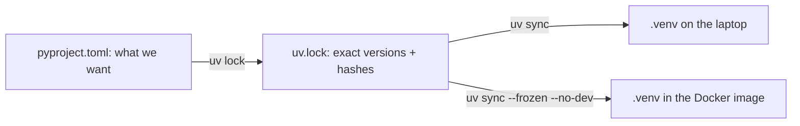

# Week of 10.14 to 10.21: FastAPI, Docker, and uv (Andrew)

## Summary
Finished the Docker side of the hello endpoint by adding a `.dockerignore` to PR #10, and measured what it actually changes. Then replaced our dependency setup with uv and a lockfile. Next up is CI (lint + pytest).

## PRs this week
| PR | What it did | State |
|---|---|---|
| [#10](https://github.com/andrewtclim/meal-prep-app/pull/10) | `/health` endpoint, Dockerfile, test, `.dockerignore` | Merged |
| [#12](https://github.com/andrewtclim/meal-prep-app/pull/12) | `pyproject.toml` and `uv.lock`, Dockerfile installs with uv, closes #7 | Open |
| [#11](https://github.com/andrewtclim/meal-prep-app/pull/11) | Author name in weekly post filenames | Merged |

## Session: 2026-10-15
### What we worked on and why
Added `.dockerignore` to PR #10 instead of a separate PR (I changed my mind from the 10-14 plan: it is a small change to the same Docker setup, and reviewers see it in one place). Then checked whether it does anything today.

### Key code
`.dockerignore`
```
.git
.env
.env.*
tests/
docs/
infra/
recipe_db_audit/
```
Everything listed is invisible to `docker build`. The main reason is safety: a future `COPY . .` would otherwise copy `.env` and the full repo into the image.

Measurement: `docker build --progress=plain` reported a context transfer of about 800 bytes with and without the file, even though the folder is 1.1 GB. BuildKit only sends files a `COPY` asks for, and our Dockerfile copies just `requirements.txt` and `app/`. So the file is insurance, not a speedup. We then ran the image and `curl localhost:8000/health` returned `{"status":"ok"}`.

### Decisions and concepts
- No new DECISIONS entry.
- CONCEPTS: [Docker build context and .dockerignore](../docs/CONCEPTS.md#docker-build-context-and-dockerignore)
- Next: GitHub Actions CI (lint + pytest), then CD.

## Session: 2026-10-17
### What we worked on and why
Replaced the dependency setup. PR #7 (open since 10-09) proposed a conda env plus a ranged `requirements.txt`, while main had exact pins from PR #10. Both had a gap: no lockfile, so sub-dependencies like starlette could change between builds, and conda plus pip meant two files to keep in sync. We moved to uv on a new branch, `chore/uv-migration`, in small steps: `pyproject.toml`, `uv.lock`, the Dockerfile, removing the old files, then verifying.

### Key code
`pyproject.toml`
```toml
[project]
name = "backend"
requires-python = ">=3.12"
dependencies = ["fastapi>=0.143,<1", "uvicorn>=0.54,<1"]

[dependency-groups]
dev = ["pytest>=8.4,<9", "httpx>=0.28,<1"]

[tool.pytest.ini_options]
pythonpath = ["."]
```
This is the recipe: the packages we chose and the versions we accept. The `dev` group replaces `requirements-dev.txt`. The name is generic on purpose (DECISIONS #13). `pythonpath` makes plain `uv run pytest` find the `app/` folder, since bare `pytest` does not add the repo root to the import path the way `python -m pytest` does.

`Dockerfile`
```dockerfile
COPY --from=ghcr.io/astral-sh/uv:0.13.1 /uv /bin/uv
COPY pyproject.toml uv.lock ./
RUN uv sync --frozen --no-dev
ENV PATH="/code/.venv/bin:$PATH"
```
The first line copies the `uv` program out of uv's official image, pinned to the version on our laptops. `uv sync --frozen` installs exactly what `uv.lock` says and fails if the lock is out of date, so the image matches the laptop. `--no-dev` leaves out pytest and httpx. The `ENV PATH` line is new because uv installs into `/code/.venv`, whose `bin` folder is not on the container's PATH, so without it `CMD ["uvicorn", ...]` would not be found. Pip used to install straight into the system Python.

### Diagram


### Decisions and concepts
- DECISIONS #22 (Proposed): uv replaces the conda plan in PR #7. Paul's WIF decision already took #21, so PR #7's #21 is not used.
- CONCEPTS: [uv](../docs/CONCEPTS.md#uv), [Lockfile](../docs/CONCEPTS.md#lockfile), and a rewritten [Dependency pinning](../docs/CONCEPTS.md#dependency-pinning)
- The lock picked fastapi 0.143.3 (we had pinned 0.143.0). We kept the range and let the verify step test it: tests pass, the container returns 200 from `/health`, and pytest is absent from the image.
- Open: Starlette now warns that `TestClient` wants `httpx2` instead of `httpx`. Only a warning, and following it adds a package, so we left it.

## What we'd explain differently next time
Why I first assumed the ignore file would speed up builds. Measure before claiming a benefit.
