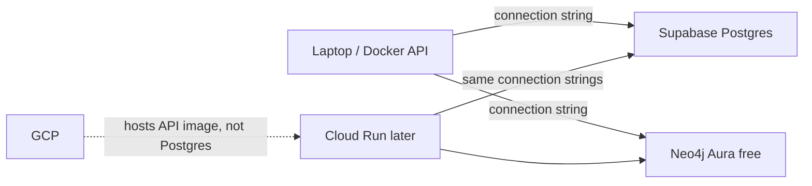

# Week of 10.14 to 10.21: Databases and dependency tooling (Paul)

## Summary
Reviewed Andrew’s uv migration (PR #12) and aligned on where our databases live: Supabase Postgres and Neo4j free tier for data, GCP for the API — not Cloud SQL for Postgres.

## PRs this week
| PR | What it did | State |
|---|---|---|
| [#5](https://github.com/andrewtclim/meal-prep-app/pull/5) | GCP foundations (Artifact Registry, WIF) | Merged |
| [#10](https://github.com/andrewtclim/meal-prep-app/pull/10) | FastAPI `/health` + Dockerfile | Merged |
| [#12](https://github.com/andrewtclim/meal-prep-app/pull/12) | Replace conda/requirements with uv + lockfile (DECISIONS #22) | Merged |
| [#13](https://github.com/andrewtclim/meal-prep-app/pull/13) | Alembic migrations for the ER diagram tables | Open |

## Session: 2026-10-18
### What we worked on and why
Finished the PR #12 review by running the uv Docker image and confirming `/health` returns `{"status":"ok"}`. Then started Week 1 database setup by reading DECISIONS #4 / ROADMAP so we don’t put Postgres in the wrong cloud.

### Key idea: where the databases live

Supabase is the system of record (recipes, pantry, users, embeddings). Neo4j holds graph relationships and is rebuilt from Postgres. GCP runs the containerized API; it is not our Postgres host (DECISIONS #4 and #10).

### Decisions and concepts
- DECISIONS #4: Postgres on Supabase + Neo4j (Accepted)
- DECISIONS #10: GCP for Cloud Run / Artifact Registry (Accepted)
- DECISIONS #22: uv for dependencies (Proposed on PR #12; signed off in review)
- CONCEPTS: [uv](../docs/CONCEPTS.md), lockfile — shopping list (`pyproject.toml`) vs receipt (`uv.lock`)

### What we’d explain differently next time
“Cloud database linked to Google Cloud” sounded like Cloud SQL. The docs mean cloud-hosted DBs (Supabase + Neo4j) that the GCP-hosted API will call — two different products linked by config, not one GCP database.

## Session: 2026-10-18 (evening) — Supabase project
### What we worked on and why
Created the Week 1 Supabase free-tier project (`Meal Prep App`) so we have a cloud Postgres for later migrations and recipe loads. Saved the Session pooler URI in a root `.env` as `DATABASE_URL` (gitignored). Connection strings live under the dashboard **Connect** button, not Settings → Database.

### Connection methods (plain English)
- **Direct:** straight to Postgres; can fail on IPv4-only networks
- **Session pooler:** middleman that reuses connections; good default for laptop/dev
- **Transaction pooler:** same middleman, stricter, for many short-lived clients

### Decisions and concepts
- DECISIONS #4: Postgres on Supabase
- Secret handling: `.env` locally, never commit; password = the one set at project create

## Session: 2026-10-18 (later) — starting Postgres migrations
### What we worked on and why
Clarified migrations vs data load: migrations are versioned scripts in the repo that create/alter tables in Supabase; bulk recipe load waits on DECISIONS #8. Chose Alembic as the tool (common with FastAPI/Postgres). Branched `feat/postgres-core-migrations` from `main`, then rebased onto `main` after PR #12 merged so installs use `uv add` instead of `requirements.txt`. Added `sqlalchemy` and `psycopg` as runtime deps and `alembic` (1.20.0) as a dev dep. `alembic init` created `alembic/` and `alembic.ini`. `alembic/env.py` reads `DATABASE_URL` from `.env` and rewrites `postgresql://` to `postgresql+psycopg://` so SQLAlchemy uses the psycopg driver. The password stays out of `alembic.ini` because that file is committed. The first `alembic current` failed with "password authentication failed" because the password in `.env` had a stray space. After removing it, Alembic connected. `uv run alembic upgrade head` then applied revision `2beee51a1f35` and created the six tables in Supabase.

### Key code
`alembic/versions/2beee51a1f35_create_core_recipe_tables.py` creates `users`, `units`, `ingredients`, `recipes`, `recipe_ingredient`, and `user_pantry`. A primary key identifies a row. A foreign key is a column that must match a primary key in another table, so a pantry row cannot point at an ingredient that does not exist. `recipe_ingredient.quantity` and `unit_id` are nullable because the recipe datasets we audited often have no amounts (DECISIONS #8). The ER diagram has eight more tables; those are the next revision, because this one was already applied.

### Decisions and concepts
- DECISIONS #2: migrations are the schema source of truth
- CONCEPTS: [Database migration (Alembic)](../docs/CONCEPTS.md#database-migration-alembic)

## Session: 2026-10-20 — rest of the ER diagram
### What we worked on and why
The first revision was already applied, so the remaining ER tables are a new file, `fe3310413886`, whose `down_revision` is `2beee51a1f35`. Editing the first file and rerunning `upgrade` would not change Supabase. `uv run alembic upgrade head` applied it (`2beee51a1f35 -> fe3310413886`). Supabase now has all 14 ER tables. `event_timestamp` stays `timestamptz` (UTC); Pacific time is a display conversion (`America/Los_Angeles`), not a column type.

### Key code
`user_cuisine` is a junction table: both `user_id` and `cuisine_id` are the primary key, and both foreign keys use `ondelete="CASCADE"`. One user can prefer many cuisines, and one cuisine can belong to many users. `user_events.event_properties` is JSONB, a Postgres column that holds a small JSON object of extra details that differ per event.

Same pattern for `user_allergen`, `ingredient_allergen`, `user_recipe`, and `user_recipe_rating` (`liked` is a boolean). Lookup tables `cuisines` and `allergens` come first so the junctions have something to point at.

### Decisions and concepts
- DECISIONS #2: a new revision, not an edit of an applied file
- CONCEPTS: [Junction table](../docs/CONCEPTS.md#junction-table)
- DATA_MODEL.md table names updated to match these migrations (`user_pantry`, `recipe_ingredient`)

## What we'd explain differently next time
Optional: fill in after Andrew reviews the schema PR.
