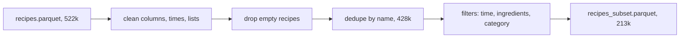

# Week of 10.21 to 10.28: Cleaning the Food.com data (Andrew)

## Summary
Read Paul's first two PRs (Alembic migrations and CI), fixed the stale ROADMAP rows, then built stage 1 of the Food.com pipeline: a script that cleans 522k raw recipes down to a 212,846-recipe subset.

## PRs this week
| PR | What it did | State |
|---|---|---|
| [#16](https://github.com/andrewtclim/meal-prep-app/pull/16) | Marks the CI and migrations rows in ROADMAP as done, accepts DECISIONS #22 | Merged |
| [#17](https://github.com/andrewtclim/meal-prep-app/pull/17) | `clean.py`, tests, DECISIONS #23 to #25, concepts | Open |

PRs reviewed, not opened by me: [#13](https://github.com/andrewtclim/meal-prep-app/pull/13) (Alembic migrations, merged), [#14](https://github.com/andrewtclim/meal-prep-app/pull/14) (Ruff and pytest in CI, merged), [#15](https://github.com/andrewtclim/meal-prep-app/pull/15) (Ruff fixes in the Alembic files, merged).

## Session: 2026-10-22
### What we worked on and why
After merging the uv PR (#12), Paul's two PRs landed on `main` along with a small lint fix. We read through them to understand them before building on them. Then we found that `docs/ROADMAP.md` still showed the CI row as unowned and the migrations row as "not merged", so we fixed both in this docs-only PR. Per DECISIONS #18 the docs are the source of truth, so a stale roadmap misleads whoever reads it next.

### Key code
`docs/ROADMAP.md`
```markdown
| GitHub Actions: lint + pytest on every PR | must | Paul | done (PR #14 merged): ... |
| First Postgres migrations: ... | must | Paul | done (PR #13 merged): Alembic migrations for the 14 ER diagram tables ... |
```
Both rows now name the owner and the PR that finished them. The rule is that finished tasks update ROADMAP in the same PR as the work, which neither of those PRs did.

What we learned from reading the PRs:
- **Alembic** keeps the schema in versioned files in git. Each revision has `upgrade()` and `downgrade()`, `down_revision` chains them in order, and the database stores its current revision in `alembic_version`, so rerunning `uv run alembic upgrade head` does nothing.
- **Ruff** is a linter: it catches real mistakes (unused imports, undefined names), not just style. **pytest** runs our tests. CI runs both on a clean machine for every PR, and it caught the lint problems in the Alembic files, which is why PR #15 exists.
- **`uv sync --locked`** fails when `uv.lock` is stale, while `--frozen` silently installs from the stale lock. CI and Docker use `--locked`.

### Decisions and concepts
- No new DECISIONS entry. #22 (uv) is still Proposed.
- CONCEPTS: [GitHub Actions CI](../docs/CONCEPTS.md#github-actions-ci), [Database migration (Alembic)](../docs/CONCEPTS.md#database-migration-alembic), [Junction table](../docs/CONCEPTS.md#junction-table), [Lockfile](../docs/CONCEPTS.md#lockfile)
- Open questions for Paul: how will loads stay idempotent (DECISIONS #14) when `recipes` has no source id, and should `ruff` get an upper version bound like our other dependencies?

## Session: 2026-10-25
### What we worked on and why
Built stage 1 of the pipeline that loads Food.com recipes: `pipelines/foodcom/clean.py`. We wrote it in five small blocks and checked the data after each one, so a bug shows up where it starts. The summary of everything it does is in [`pipelines/foodcom/README.md`](../pipelines/foodcom/README.md).

### Key code
`pipelines/foodcom/clean.py`
```python
def parse_duration_minutes(value) -> int | None:
    match = DURATION_RE.match(value.strip())
    if match is None or not any(match.groups()):
        return None
    hours, minutes, seconds = (int(g) if g else 0 for g in match.groups())
    return hours * 60 + minutes + round(seconds / 60)
```
Turns `"PT1H30M"` into `90`. We profiled the real formats first and found `PT0S` (zero) and a few negative values, so anything the pattern does not match returns `None` and not a wrong number. A missing time must not become `0`, because a `0` would pass the "under 90 minutes" filter.

```python
ranked = df.sort_values(["aggregated_rating", "review_count", "source_ref"],
                        ascending=[False, False, True], na_position="last")
deduped = ranked.drop_duplicates(subset="name_key", keep="first")
```
Keeps one recipe per normalized name: best rated, then most reviewed, then lowest `source_ref`. The last rule makes the pick depend only on the data, so reruns choose the same row. The paid LLM results in stage 2 are keyed by `source_ref`, so a different pick would break them.

### Diagram


### Decisions and concepts
- DECISIONS #23 (Food.com 2020 and the license position), #24 (pipeline design, amends #14), #25 (the 212,846-recipe subset). All Proposed; Paul needs to sign off on #23.
- CONCEPTS: [Parquet](../docs/CONCEPTS.md#parquet), [Deterministic vs idempotent pipelines](../docs/CONCEPTS.md#deterministic-vs-idempotent-pipelines), [Deduplication by normalized key](../docs/CONCEPTS.md#deduplication-by-normalized-key), [Dependency groups](../docs/CONCEPTS.md#dependency-groups)
- The category filter began as a list of dinner categories I guessed from the top 70 values. It was biased toward meat, so we switched to excluding the clearly-not-dinner groups.
- Open: 213k recipes is about 310 MB of data per copy, over the free database limit. We need a larger Supabase plan or a single stored copy before stage 3.

## What we'd explain differently next time
What `down_revision` does and why running the same migration command twice is safe.
