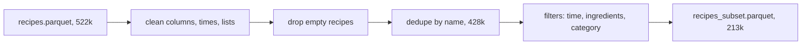
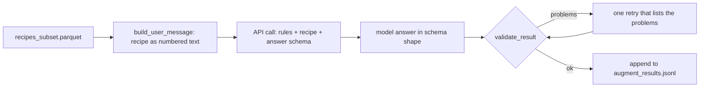

# Week of 10.21 to 10.28: Cleaning the Food.com data (Andrew)

## Summary
Read Paul's first two PRs (Alembic migrations and CI), fixed the stale ROADMAP rows, then built stage 1 of the Food.com pipeline (a script that cleans 522k raw recipes down to a 212,846-recipe subset) and started stage 2, where a Claude model adds units and cuisines. Stage 2 has a working 3-recipe test; the full run waits on a budget talk.

## PRs this week
| PR | What it did | State |
|---|---|---|
| [#16](https://github.com/andrewtclim/meal-prep-app/pull/16) | Marks the CI and migrations rows in ROADMAP as done, accepts DECISIONS #22 | Merged |
| [#17](https://github.com/andrewtclim/meal-prep-app/pull/17) | `clean.py`, tests, DECISIONS #23 to #25, concepts | Open |
| [#18](https://github.com/andrewtclim/meal-prep-app/pull/18) | `augment.py`, tests, DECISIONS #26, concepts, `.env.example` | Draft |

PRs reviewed, not opened by me: [#13](https://github.com/andrewtclim/meal-prep-app/pull/13) (Alembic migrations, merged), [#14](https://github.com/andrewtclim/meal-prep-app/pull/14) (Ruff and pytest in CI, merged), [#15](https://github.com/andrewtclim/meal-prep-app/pull/15) (Ruff fixes in the Alembic files, merged).

## Session: 2026-10-22
### What we worked on and why
After merging the uv PR (#12), Paul's two PRs landed on `main` along with a small lint fix. We read through them to understand them before building on them. Then we found that `docs/ROADMAP.md` still showed the CI row as unowned and the migrations row as "not merged", so we fixed both in this docs-only PR. Per DECISIONS #18 the docs are the source of truth, so a stale roadmap misleads whoever reads it next.

### Key code
`docs/ROADMAP.md`
```markdown
| GitHub Actions: lint + pytest on every PR | must | Paul | done (PR #14 merged): ... |
| First Postgres migrations: ... | must | Paul | done (PR #13 merged): Alembic migrations for the 14 ER diagram tables ... |
```
Both rows now name the owner and the PR that finished them. The rule is that finished tasks update ROADMAP in the same PR as the work, which neither of those PRs did.

What we learned from reading the PRs:
- **Alembic** keeps the schema in versioned files in git. Each revision has `upgrade()` and `downgrade()`, `down_revision` chains them in order, and the database stores its current revision in `alembic_version`, so rerunning `uv run alembic upgrade head` does nothing.
- **Ruff** is a linter: it catches real mistakes (unused imports, undefined names), not just style. **pytest** runs our tests. CI runs both on a clean machine for every PR, and it caught the lint problems in the Alembic files, which is why PR #15 exists.
- **`uv sync --locked`** fails when `uv.lock` is stale, while `--frozen` silently installs from the stale lock. CI and Docker use `--locked`.

### Decisions and concepts
- No new DECISIONS entry. #22 (uv) is still Proposed.
- CONCEPTS: [GitHub Actions CI](../docs/CONCEPTS.md#github-actions-ci), [Database migration (Alembic)](../docs/CONCEPTS.md#database-migration-alembic), [Junction table](../docs/CONCEPTS.md#junction-table), [Lockfile](../docs/CONCEPTS.md#lockfile)
- Open questions for Paul: how will loads stay idempotent (DECISIONS #14) when `recipes` has no source id, and should `ruff` get an upper version bound like our other dependencies?

## Session: 2026-10-25
### What we worked on and why
Built stage 1 of the pipeline that loads Food.com recipes: `pipelines/foodcom/clean.py`. We wrote it in five small blocks and checked the data after each one, so a bug shows up where it starts. The summary of everything it does is in [`pipelines/foodcom/README.md`](../pipelines/foodcom/README.md).

### Key code
`pipelines/foodcom/clean.py`
```python
def parse_duration_minutes(value) -> int | None:
    match = DURATION_RE.match(value.strip())
    if match is None or not any(match.groups()):
        return None
    hours, minutes, seconds = (int(g) if g else 0 for g in match.groups())
    return hours * 60 + minutes + round(seconds / 60)
```
Turns `"PT1H30M"` into `90`. We profiled the real formats first and found `PT0S` (zero) and a few negative values, so anything the pattern does not match returns `None` and not a wrong number. A missing time must not become `0`, because a `0` would pass the "under 90 minutes" filter.

```python
ranked = df.sort_values(["aggregated_rating", "review_count", "source_ref"],
                        ascending=[False, False, True], na_position="last")
deduped = ranked.drop_duplicates(subset="name_key", keep="first")
```
Keeps one recipe per normalized name: best rated, then most reviewed, then lowest `source_ref`. The last rule makes the pick depend only on the data, so reruns choose the same row. The paid LLM results in stage 2 are keyed by `source_ref`, so a different pick would break them.

### Diagram


### Decisions and concepts
- DECISIONS #23 (Food.com 2020 and the license position), #24 (pipeline design, amends #14), #25 (the 212,846-recipe subset). All Proposed; Paul needs to sign off on #23.
- CONCEPTS: [Parquet](../docs/CONCEPTS.md#parquet), [Deterministic vs idempotent pipelines](../docs/CONCEPTS.md#deterministic-vs-idempotent-pipelines), [Deduplication by normalized key](../docs/CONCEPTS.md#deduplication-by-normalized-key), [Dependency groups](../docs/CONCEPTS.md#dependency-groups)
- The category filter began as a list of dinner categories I guessed from the top 70 values. It was biased toward meat, so we switched to excluding the clearly-not-dinner groups.
- Open: 213k recipes is about 310 MB of data per copy, over the free database limit. We need a larger Supabase plan or a single stored copy before stage 3.

## Session: 2026-10-27
### What we worked on and why
Paul reviewed PR #17 and left five comments. We checked each one against the data before changing anything, then fixed them on the same branch as separate commits, so the PR updated in place and each comment thread could point to one commit.

### Key code
`pipelines/foodcom/clean.py`
```python
def count_nonblank(items: list[str]) -> int:
    return sum(1 for item in items if item)
```
The ingredient filter used `len()`, which counts blank slots (`["salt", "", ""]` passed the 3-ingredient minimum). It now counts non-blank items. In this data no recipe has a blank ingredient part, so the subset stayed at 212,846, but the filter is now correct for future data.

```python
return hours * 60 + minutes + math.ceil(seconds / 60)
```
Python's `round(30 / 60)` is 0 (it rounds halves to the even number), so `PT30S` would have become 0 and then missing. `ceil` makes any positive duration at least 1 minute. No effect today: the raw file has no durations with a nonzero seconds part.

### Decisions and concepts
- **Mistake and fix:** I edited the status line of DECISIONS #14, which is Accepted, citing a precedent. The rule says never edit an accepted entry, and #24 already records the amendment, so it was reverted. Editing #8 (still Open) was fine.
- **The 90-minute cutoff** is a judgment call, not derived from the data. The sensitivity table (60 / 90 / 120 / 180 minutes gives 180,740 / 212,846 / 222,269 / 232,064 recipes) is now in DECISIONS #25.
- **Known limit, left as is:** hyphens become spaces, so `lemon-ade` does not match `lemonade`. Joining them would break `Chocolate-Chip Cookies`.

## Session: 2026-10-27 (part 2): starting stage 2
### What we worked on and why
Stage 1 gave us clean recipes with no units, so stage 2 asks a Claude model to read each recipe and fill in an amount, a unit and the cuisines. We built it in blocks, with tests that use a fake client so nothing costs money until we choose. We stopped after a 3-recipe test against the real API. We are not running the full set yet because it costs money and we want to agree a budget first.

### Diagram


### Key code
`pipelines/foodcom/augment.py`
```python
"output_config": {
    "effort": "low",
    "format": {"type": "json_schema", "schema": build_output_schema()},
},
```
The `format` key sends our schema with the request, and the API makes the answer fit it, so the model cannot invent a unit or leave out a field. `effort: low` keeps the thinking short, because this is extraction, not hard reasoning.

```python
"ingredients": {"type": "array", "items": {"properties": {
    "position": {"type": "integer"},
    "quantity": {"type": ["number", "null"]},
    "unit": {"type": "string", "enum": UNITS}}}}
```
The model answers by ingredient position and not by repeating the name. In 10.1% of recipes the same ingredient appears twice (butter for the filling and again for the sauce), so a name cannot tell the two apart, and a position can. It is also fewer output tokens, which cost 5 times as much as input.

```python
def validate_result(result: dict, n_ingredients: int) -> list[str]:
```
The schema cannot say "exactly one entry per ingredient" or "null quantity only for to-taste", so this checks them and returns a list of problems. The list becomes the text of the one retry, so the model is told what to fix.

```python
def load_done_keys(path) -> set[str]:
    ...
    return {r["recipe_key"] for r in records if r["status"] == "ok"}
```
Each result is appended to a file as it arrives, and a rerun skips the recipes already saved. The key is our `recipe_key`, not a list position, because batch results come back in any order and the key must mean the same recipe on every run.

### Results of the 3-recipe test
| Recipe | Ingredients | Cuisines | Tokens in / out | Attempts |
|---|---|---|---|---|
| Blue Ribbon Kielbasa | 5 | other, american | 1,450 / 504 | 1 |
| Gorgonzola Pear Crostini | 9 | italian, american | 1,531 / 635 | 1 |
| Chicken Breast With Grand Marinier Sauce | 13 | french, american | 1,719 / 966 | 1 |

All three passed validation on the first try. The full per-ingredient table for the chicken recipe is in `pipelines/foodcom/README.md`. Accuracy was only eyeballed, not measured. Cost came out at about twice our estimate (1,570 tokens in and 700 out per recipe), which projects to about $54 for the full run through the Batches API. That is a rough figure from three recipes.

### Decisions and concepts
- **Decision:** [DECISIONS #26](../docs/DECISIONS.md) (Proposed): structured outputs, fixed unit and cuisine lists, pilot first, Haiku 5.5 on trial.
- **Concepts added to `docs/CONCEPTS.md`:** structured outputs and closed vocabularies, baseline for evaluation, append-only results file, environment file and `.env.example`, LLM cost (input, output, thinking, batching).
- **Cuisine baseline:** a keyword lookup labels only 15.9% of recipes and cannot name Italian or French at all, because no tag in the data does. That is the gap the model is there to fill.
- **Mistakes caught:** my first cost estimate (about $30) was low by half, because I guessed token counts from text length. A real call showed the difference.

## What we'd explain differently next time
What `down_revision` does and why running the same migration command twice is safe.
