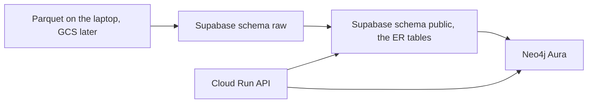

# Week of 10.21 to 10.28: CI lint and pytest (Paul)

## Summary
Started the Week 1 GitHub Actions task: a workflow that runs a linter and pytest on every pull request. This does not deploy anything and does not need GCP.

## PRs this week
| PR | What it did | State |
|---|---|---|
| [#13](https://github.com/andrewtclim/meal-prep-app/pull/13) | Alembic migrations for the ER diagram tables | Open |

## Session: 2026-10-21
### What we worked on and why
Branched `feat/ci-lint-pytest` from `main`. CI is the remaining Week 1 task that does not depend on the recipe dataset or on PR #13. The workflow will run on GitHub's machines when a PR opens. Added Ruff with `uv add --dev ruff`. It is in the `dev` group in `pyproject.toml` next to pytest (`ruff>=0.17.1`). `uv run ruff check .` from the repo root reported all checks passed. `ruff check` only reports issues; it does not edit files. `uv run pytest` passed the one health test. Starlette prints a deprecation warning that `TestClient` prefers `httpx2`; the test still exits 0. PR #12 noted the same warning and left it alone.

### Key idea: `uv add --dev` and Docker
`uv add --dev ruff` adds Ruff to the `dev` list in `pyproject.toml`, records Ruff and its dependencies in `uv.lock`, and installs it into `.venv`. `--dev` means the package is for working on the repo, not for running the API.

The image skips that list because the Dockerfile asks it to:

`Dockerfile`

```dockerfile
RUN uv sync --locked --no-dev
```

`--no-dev` installs only the main dependencies (FastAPI, uvicorn). Pytest and Ruff stay off the image. CI calls `uv sync --locked --dev` so it can lint and test.

### Key code
`.github/workflows/ci.yml` is the workflow. GitHub runs it on a fresh Ubuntu machine, not on a laptop.

```yaml
name: CI

on:
  pull_request:
  push:
    branches: [main]
```

`name` is the label in the GitHub checks list. `on` is the trigger: every pull request, and every push to `main`.

```yaml
jobs:
  lint-and-test:
    runs-on: ubuntu-latest
    steps:
      - uses: actions/checkout@v4
```

One job, named `lint-and-test`, on GitHub's current Ubuntu image. `checkout` copies this repo onto that machine. Without it, the later commands would have no files.

```yaml
      - name: Install uv
        uses: astral-sh/setup-uv@v5
        with:
          python-version: "3.12"
```

`uses` runs someone else's published action instead of a shell command. This one installs uv and Python 3.12, matching `requires-python` in `pyproject.toml`.

```yaml
      - name: Install dependencies
        run: uv sync --locked --dev

      - name: Lint
        run: uv run ruff check .

      - name: Test
        run: uv run pytest
```

`run` is a shell command. `--locked` fails the job if `uv.lock` does not match `pyproject.toml`. `--dev` installs pytest and Ruff, which the Docker image skips with `--no-dev`. The last two lines are the same commands that passed locally. If either exits with an error, the check on the PR goes red.

### Decisions and concepts
- DECISIONS #22: uv, with a dev group and `uv sync --locked --no-dev` in Docker
- CONCEPTS: [uv](../docs/CONCEPTS.md#uv), [GitHub Actions CI](../docs/CONCEPTS.md#github-actions-ci)

## Session: 2026-10-21 (evening) — broken lockfile blocked the merge
### What we worked on and why
Andrew approved PR #14, then the merge button failed. PR #13 had landed on `main` while this branch was open. Updating the branch merged two copies of `uv.lock` into one invalid file: the `ruff` package entry was never closed before `sqlalchemy` started. GitHub's check stopped at `uv sync --locked --dev` ("Install dependencies"). Ruff and pytest never ran. `uv lock` could not repair it, because uv reads the existing lockfile first and refused to parse it. Deleting `uv.lock` and running `uv lock` again rebuilt it from `pyproject.toml`, which already listed both Ruff and Alembic.

### Decisions and concepts
- CONCEPTS: [Lockfile](../docs/CONCEPTS.md#lockfile). `--locked` is what made CI fail instead of silently installing a different set.

## Session: 2026-10-24 — where the Kaggle parquet lives
### What we worked on and why
Talked through the database layout before any recipe load. The Food.com candidate is a parquet file from Kaggle. Postgres does not open that file. The file stays on disk, and a loader copies rows into Supabase.



`raw` matches the parquet columns. dbt reads `raw` and writes the ER tables Alembic already created. User rows (pantry, ratings) are inserted by the app and never come from the file. Neo4j is rebuilt from the clean tables. Cloud Run runs the API and holds no recipe rows.

The free tier is about 500 MB, and storing both the raw copy and the clean tables counts against that. The loader should filter to the weeknight subset before insert. If both copies still do not fit, the parquet file itself would stay the raw layer and only clean rows would go to Supabase. That would be a new decision, because [DECISIONS #14](../docs/DECISIONS.md) says the raw copy lives in Postgres. Nothing is loaded yet: [DECISIONS #8](../docs/DECISIONS.md) is still open.

### Decisions and concepts
- DECISIONS #4: Supabase is the system of record, Neo4j is rebuilt from it
- DECISIONS #14: raw schema, then transforms
- DECISIONS #8: license and the 500 MB subset, still open
