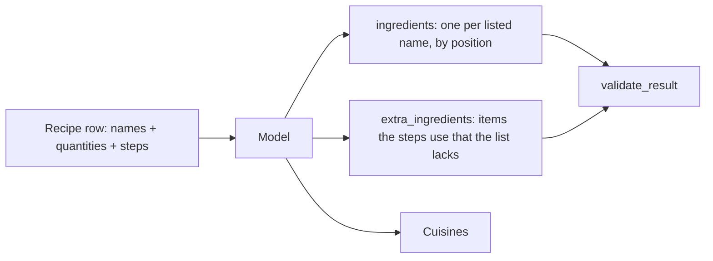

# Week of 10.28 to 11.04: Fixing the incomplete ingredient list in the Food.com augment step (Andrew)

## Summary
After the 200-recipe pilot we checked an assumption we had never tested: that each recipe's `ingredient_parts` list is complete. It is not, so the stage 2 model now also returns `extra_ingredients` for items the steps use that the list lacks. This week is the fix, its tests and docs. Next come a wider cuisine list, parameter experiments, and a 20-recipe comparison of thinking on and off.

## PRs this week
| PR | What it did | State |
|---|---|---|
| [#17](https://github.com/andrewtclim/meal-prep-app/pull/17) | `clean.py`, tests, DECISIONS #23 to #25, concepts | Merged (merge commit) |
| [#18](https://github.com/andrewtclim/meal-prep-app/pull/18) | `augment.py`, tests, DECISIONS #26, concepts, `.env.example`; now also `extra_ingredients` | Draft, base retargeted to `main` |

## Session: 2026-10-29
### What we worked on and why
Paul and I talked over the pilot results. One of the points was that we use the ingredient list as the anchor for the model's answer, yet we had seen more quantities than ingredients. We did not know which list was incomplete, so before widening anything we checked it on real rows (no API cost). PR #17 had merged, so PR #18 was retargeted from the stacked branch to `main` first; with a merge commit nothing had to be replayed, so no rebase was needed.

**What the check found.** On the 212,846-row subset, 21% of recipes have as many quantities as names, 75% have more, and 4% have fewer. Sample rows made the cause clear:

| Field | Joe's Saute Onions |
|---|---|
| `ingredient_parts` (4) | olive oil, salt, butter, sugar |
| `quantities_raw` (5) | `1 -3` and four blanks |
| Steps | "Slice off the root and top ends of the onions, peel the onions..." |

The recipe is about onions, they are not in the list, and the first quantity is theirs. A rough keyword check (a staple word in the steps but in no ingredient name) flagged 54% of the "more quantities" group against 32% of the aligned recipes. The aligned group is the noise floor, since salt and water are often left off lists on purpose. So the real gap is about 21 points, and it is an estimate, not a measured miss rate.



### Key code
`pipelines/foodcom/augment.py` (schema)
```python
"extra_ingredients": {
    "type": "array",
    "items": {"name": string, "quantity": number|null, "unit": <UNITS enum>},
},
...
"required": ["ingredients", "extra_ingredients", "cuisines"],
```
The API now forces every answer to include the field. It is required so that `[]` means "the model checked and found nothing"; an optional field could also mean it skipped the check. Extras are keyed by `name` because they have no position in the source list.

`pipelines/foodcom/augment.py` (validator)
```python
extras = result.get("extra_ingredients", [])
if len(extras) > MAX_EXTRA_INGREDIENTS: ...
for e in extras:
    if name in EXTRA_BANNED_NAMES: ...   # salt, water
    elif name in taken: ...              # already listed, or listed twice
    problems += quantity_problems(f"extra '{name}'", e.get("quantity"), e.get("unit"))
```
The schema can only guarantee shape. The cap, the no-repeat rule and the salt/water rule depend on the recipe, so code checks them after the fact, and any problem goes into the one retry. `quantity_problems` is shared with listed ingredients so both follow the same null-with-`to_taste` rule. Repeat detection is an exact, case-insensitive match, so "garlic" still slips past "garlic cloves"; fuzzy matching could wrongly reject a real extra such as peanut butter, so exact is the safer start.

**Result of a 5-recipe test on the new schema ($0.0035).** All five validated on the first try and the model found every missing item we had spotted by eye: onions, feta, cooking spray, oil, taco seasoning mix, roasted peppers and squid. It never added salt or water. Open questions for the hand check: the model gave 3 onions for a source of `1 -3` where our rule says the midpoint, 2; and amounts for some extras (oil, 2 tbsp) cannot be checked against the quantities. Input rose by roughly 400 tokens per recipe, but the sample was biased toward long recipes, so the cost comparison waits for the matched 20-recipe pilot.

### Decisions and concepts
- DECISIONS #26 amendment (still Proposed): the finding, the six rules for extras, the tradeoffs. Paul has not signed off yet.
- CONCEPTS: [Anchor and completeness check](../docs/CONCEPTS.md#anchor-and-completeness-check)
- DATA_MODEL: `recipe_ingredient` will hold listed and extra rows with a proposed `is_extra` flag.

## What we'd explain differently next time
I wrote "the ingredient list is the anchor" as a design assumption while already holding the stage 1 number that only 22% of lists match the quantities, and did not ask what the extras were. The check cost nothing and took minutes. The habit to keep: when a join key looks tidy, compare it with a second signal on a sample before building on it.
