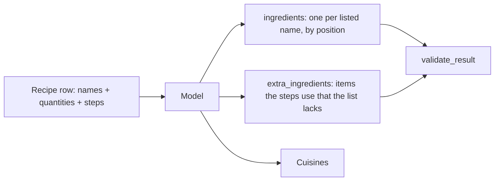
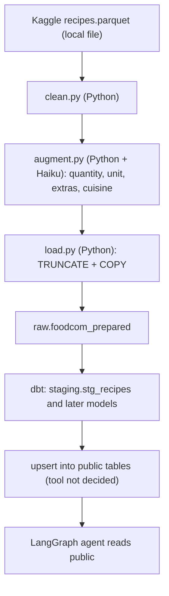

# Week of 10.28 to 11.04: Fixing the incomplete ingredient list in the Food.com augment step (Andrew)

## Summary
After the 200-recipe pilot we checked an assumption we had never tested: that each recipe's `ingredient_parts` list is complete. It is not, so the stage 2 model now also returns `extra_ingredients` for items the steps use that the list lacks. We also widened the cuisine list from 20 to 90 and cut the cap to 2 per recipe. We then ran a 20-recipe comparison of thinking on and off, built a notebook to review it, and fixed a result-key bug Paul found in review (PR #18). Paul reviewed it (changes requested) and chose thinking; we then fixed the three things he asked for. On 11-03 I reviewed Paul's two dbt PRs and found they still expected the old answer shape.

## PRs this week
| PR | What it did | State |
|---|---|---|
| [#17](https://github.com/andrewtclim/meal-prep-app/pull/17) | `clean.py`, tests, DECISIONS #23 to #25, concepts | Merged (merge commit) |
| [#18](https://github.com/andrewtclim/meal-prep-app/pull/18) | `augment.py`, tests, DECISIONS #26, concepts, `.env.example`; now also `extra_ingredients` | Merged |
| [#20](https://github.com/andrewtclim/meal-prep-app/pull/20) | Paul's: `raw` schema migration, `load.py`, DECISIONS #27. I reviewed it and posted the drift findings | Open |
| [#21](https://github.com/andrewtclim/meal-prep-app/pull/21) | Paul's: dbt project and staging model, stacked on #20 | Open |

## Session: 2026-10-29
### What we worked on and why
Paul and I talked over the pilot results. One of the points was that we use the ingredient list as the anchor for the model's answer, yet we had seen more quantities than ingredients. We did not know which list was incomplete, so before widening anything we checked it on real rows (no API cost). PR #17 had merged, so PR #18 was retargeted from the stacked branch to `main` first; with a merge commit nothing had to be replayed, so no rebase was needed.

**What the check found.** On the 212,846-row subset, 21% of recipes have as many quantities as names, 75% have more, and 4% have fewer. Sample rows made the cause clear:

| Field | Joe's Saute Onions |
|---|---|
| `ingredient_parts` (4) | olive oil, salt, butter, sugar |
| `quantities_raw` (5) | `1 -3` and four blanks |
| Steps | "Slice off the root and top ends of the onions, peel the onions..." |

The recipe is about onions, they are not in the list, and the first quantity is theirs. A rough keyword check (a staple word in the steps but in no ingredient name) flagged 54% of the "more quantities" group against 32% of the aligned recipes. The aligned group is the noise floor, since salt and water are often left off lists on purpose. So the real gap is about 21 points, and it is an estimate, not a measured miss rate.



### Key code
`pipelines/foodcom/augment.py` (schema)
```python
"extra_ingredients": {
    "type": "array",
    "items": {"name": string, "quantity": number|null, "unit": <UNITS enum>},
},
...
"required": ["ingredients", "extra_ingredients", "cuisines"],
```
The API now forces every answer to include the field. It is required so that `[]` means "the model checked and found nothing"; an optional field could also mean it skipped the check. Extras are keyed by `name` because they have no position in the source list.

`pipelines/foodcom/augment.py` (validator)
```python
extras = result.get("extra_ingredients", [])
if len(extras) > MAX_EXTRA_INGREDIENTS: ...
for e in extras:
    if name in EXTRA_BANNED_NAMES: ...   # salt, water
    elif name in taken: ...              # already listed, or listed twice
    problems += quantity_problems(f"extra '{name}'", e.get("quantity"), e.get("unit"))
```
The schema can only guarantee shape. The cap, the no-repeat rule and the salt/water rule depend on the recipe, so code checks them after the fact, and any problem goes into the one retry. `quantity_problems` is shared with listed ingredients so both follow the same null-with-`to_taste` rule. Repeat detection first matched names exactly. The corn bake recipe (an extra named "cheddar cheese, shredded (for topping)" next to a listed "cheddar cheese") showed that is too weak. A first fix rejected any extra containing a listed word, which would have wrongly rejected "peanut butter" next to "butter" and cost a pointless retry. The final rule is narrower: an extra is rejected only if it equals a listed name or is a listed name followed by a descriptor after a comma, bracket or dash. On the 82 extras we had saved it flags one true duplicate and no false alarm.

**Result of a 5-recipe test on the new schema ($0.0035).** All five validated on the first try and the model found every missing item we had spotted by eye: onions, feta, cooking spray, oil, taco seasoning mix, roasted peppers and squid. It never added salt or water. Open questions for the hand check: the model gave 3 onions for a source of `1 -3` where our rule says the midpoint, 2; and amounts for some extras (oil, 2 tbsp) cannot be checked against the quantities. Input rose by roughly 400 tokens per recipe, but the sample was biased toward long recipes, so the cost comparison waits for the matched 20-recipe pilot.

### Decisions and concepts
- DECISIONS #26 amendment (still Proposed): the finding, the six rules for extras, the tradeoffs. Paul has not signed off yet.
- CONCEPTS: [Anchor and completeness check](../docs/CONCEPTS.md#anchor-and-completeness-check)
- DATA_MODEL: `recipe_ingredient` will hold listed and extra rows with a proposed `is_extra` flag.

### Cuisines: 20 to 90 labels, at most 2 per recipe
Paul and I wanted something close to the 75 to 100 most common cuisines. We scanned Food.com's own tags (64 cuisine and region words exist, most with a few hundred recipes) and added the ones it lacks: italian, french, american, british, irish, mediterranean, israeli and others. `kosher` is a diet and `european`/`asian` are too coarse, so they are out. We merged near-duplicates the model cannot reliably separate (scottish and welsh into british, szechuan and hunan into chinese, lebanese and turkish into middle_eastern), but kept `cantonese`, and kept `italian` and `mediterranean` apart because the model sees the dish name and steps. The cap went from 3 to 2: in the pilot 97 of 200 recipes used two cuisines and only 3 used a third.

`pipelines/foodcom/augment.py`
```python
MAX_CUISINES = 2
CUISINE_KEYWORDS = {tag: tag.replace(" ", "_") for tag in _SAME_NAME_TAGS} | {
    "scottish": "british", "welsh": "british", "szechuan": "chinese", ...
}
```
Most Food.com tags now map to the same-named cuisine, so the baseline table is built from a list of names plus a handful of folded or renamed ones instead of 90 hand-typed pairs. Baseline coverage rose from 15.9% to 20.1% of the subset.

**API test.** The API accepted the 90-value schema (2 recipes, $0.0013). Input rose by exactly 677 tokens per call on both recipes, which is about +$14 direct or +$7 batch over 212,846 recipes. Two recipes also changed behaviour: Joe's onions went from `american` to `other`, and the spinach triangles from `greek, mediterranean` to `greek`. That is two recipes, an observation and not a measurement.

**The risk we have not measured:** near-neighbour confusion (labels covering almost the same food). The repeatability run and the hand check come next. CONCEPTS: [Label granularity and near-neighbour confusion](../docs/CONCEPTS.md#label-granularity-and-near-neighbour-confusion). DECISIONS #26 has a second amendment for this.

### Parameter experiments (about $0.03)
A learning step: what do the dials on a request do, on 5 messy recipes? We added optional `effort`, `thinking` and `max_tokens` arguments to `build_request_params` (defaults unchanged) and logged `thinking_tokens` per record.

| Experiment | Result |
|---|---|
| `max_tokens` 300 vs 4096 | 300 cut off all 5 first attempts (thinking ate the cap); 3 of 5 still failed after the retry; cost went up ($0.0043 vs $0.0039) because the retry resends the input |
| `effort` low / medium / high | cost $0.0039 / $0.0040 / $0.0049; thinking was 71 to 79% of output; `low` stays |
| Repeatability: `low` three times | 15 to 17 of 47 ingredient entries differ between identical runs, about the same as `medium` or `high` vs `low` (19 to 21); 4 of 5 recipes changed cuisine set at least once |
| `temperature` | the Python SDK has no such argument; sent via `extra_body`, the API returns 400 "temperature: Extra inputs are not permitted" (same for `top_p`) |

```python
def build_request_params(recipe, problems=None, *, effort=EFFORT, thinking=None, max_tokens=MAX_OUTPUT_TOKENS): ...
```
The defaults equal the production setting, so nothing changes for normal runs; experiments pass the dials in. The saved record gains `thinking_tokens` and `mode` for the later thinking-on versus thinking-off pilot.

What to take away: `max_tokens` is a safety limit, not a cost dial; the model's answers on messy recipes are noisy, so consistency has to come from the schema, validator, closed lists and prompt rules, and a hand check has to say which answers are right. The cuisine flips (`mediterranean`, `tex_mex`, `american`) are the near-neighbour confusion made visible. CONCEPTS: [Request dials](../docs/CONCEPTS.md#request-dials-max_tokens-effort-thinking-and-temperature).

### Thinking vs no thinking: 20 recipes, and a review notebook
We ran the same stratified 20 recipes with Claude's default thinking and with thinking off. The sample is 7 recipes where raw quantities line up with the ingredient names, 10 with extra quantities and 3 with fewer, and we changed the seed from 7 to 2026 after noticing seed 7 had drawn recipes we had already read while writing the prompt. Judging the final result on them would flatter it, which is a small case of data leakage.

`pipelines/foodcom/augment.py`
```python
COMPARE_QUOTAS = {"equal": 7, "more": 10, "fewer": 3}
sample = stratified_sample(df, COMPARE_QUOTAS, COMPARE_SEED)
options = {"thinking": THINKING_OFF} if mode == "nothinking" else {}
```
Both modes draw the same recipes from a fixed seed, and each writes its own results file, because resume is keyed by one id and would otherwise skip the second mode entirely.

| | Thinking | No thinking |
|---|---|---|
| Valid | 20/20 | 20/20 |
| Retries | 0 | 2 |
| Output tokens / recipe | 932 | 288 |
| Full run, direct / Batches | ~$160 / ~$80 | ~$93 / ~$46 |

Thinking off saves about 42%, but the two modes differ on 29% of ingredient entries, about the same as two identical thinking runs differ from each other, so cost alone cannot decide. The base estimate also rose from $108 to about $160 because of the extras and the 90 cuisines.

We first made `review.csv` a 216-row file and the notebook too long. We redid it as a short review tool: one card per recipe (steps, ingredient table with the raw quantity beside each name, both answers with differences highlighted) and a small cell to set a verdict. The Cheesy Scalloped Corn Bake card showed a limit of both modes: the dish is about corn, corn is not in the ingredient list, and the steps give no amounts.

**Paul's review of PR #18** found a real bug: saved results were keyed on `recipe_key`, a position number that shifts if stage 1 changes. We now key on Food.com's `source_ref`, migrated the 240 saved records (0 mismatches), and corrected the docs. His second comment (the second cuisine is mostly filler) was true of the old prompt; after the prompt change only 1 of 20 thinking recipes and 6 of 20 no-thinking recipes had a second cuisine, so we kept the cap at 2 for now. Decided after the review (see the next section): thinking.

### Paul's review (2026-11-02): changes requested, and what we did
Paul reviewed the PR and the notebook. He picked **thinking**: the no-thinking mode was fine on most recipes, but when it was wrong it was wrong by a lot (lemon juice `1 cup` instead of `1 tbsp`, parmesan `1 tbsp` for 2 lb of fava beans, basil `12 pieces` where the steps need about 36 tsp). My count-based comparison (29% of entries differ) hid the size of those errors. I had the opposite first impression from a quick skim; his specific examples changed my mind.

| His request | What we did |
|---|---|
| Old-schema results would be skipped on resume | Every record now has a `schema_version` and a rerun only counts the current version as done. The 200 old pilot records are archived, and the 40 comparison records are stamped version 2 as the evidence he reviewed |
| The second cuisine looks like filler | One `cuisine` per recipe. A small `CUISINE_PARENT` table in code adds the parent (cantonese gives chinese). I had justified two cuisines with "97 of 200 recipes used two", which was inflated by filler like `american`; his follow-up data (the modes disagreed on the first cuisine for 7 of 20) was the better evidence |
| `package` is ambiguous (lasagna: `1 package` vs `1 lb`) | `package` is removed and the prompt says to give a weight for packaged goods. The other loose units (can, bunch, pinch, dash, piece) stay open for the team meeting |

```python
SCHEMA_VERSION = 3
return {r["source_ref"] for r in records if r["status"] == "ok" and r.get("schema_version") == SCHEMA_VERSION}
```
The resume check asks not only "is this recipe saved?" but "was it saved under the current rules?", so changing the prompt or validator cannot leave stale answers mixed into the final data. A real 3-recipe check on version 3 ($0.0022) gave `lb` for the lasagna cheeses and `1 tbsp` for the lemon juice. Three recipes, one run each, so not proof. Still open: the backup of the results file, and recipes whose main ingredient appears only in the title (the corn bake).

## Session: 2026-11-03
### What we worked on and why
Paul opened two PRs for stage 3 (loading into Postgres and transforming with dbt) while I was changing stage 2 in PR #18. I reviewed them and went through the dbt files block by block, since I had not used dbt before.

### Diagram
The whole path, from the Kaggle file to the agent. Alembic builds the empty tables but is not a step in the flow.



### What I learned about dbt
| Idea | The short version |
|---|---|
| A dbt model | One `.sql` file holding one `select`. dbt wraps it in `create view` or `create table` and sends it to Postgres |
| `view` vs `table` | A view is a saved `select` with no stored rows; a table is a stored copy that goes stale until the next `dbt run` |
| `source()` | Tells dbt about a table it did not build (`raw.foodcom_prepared`, made by `load.py`), which gives lineage and lets us test the raw data |
| `->` vs `->>` | `->` returns jsonb, `->>` returns text. The lists stay jsonb in staging so the next model can turn them into rows |
| dbt tests | Run on the real data, unlike pytest. `not_null` passes on `[]`, so they check shape, not correctness |
| Who builds vs who fills | Alembic builds the `public` tables; dbt creates new views and tables from selects and does not insert into existing ones. That is why the last step into `public` is an upsert (other tables point at `recipe_id`) and Paul is still deciding how it runs |

### The finding: schema drift
After the PR #18 review the answer carries one `cuisine` string and every record has a `schema_version`. Paul's branches still expected the old shape, so I tested his own validator on both:

| Where | Problem | Evidence |
|---|---|---|
| `load.py` line 35 | requires `cuisines`, so every version-3 record fails with `missing key 'cuisines'` | a version-3 results file gave 0 usable rows (it stops safely with "nothing to load") |
| `stg_recipes.sql` line 12 | `answer -> 'cuisines'` is null for version 3, so the `cuisines_json not_null` test would fail | read from the SQL, I did not run dbt |
| `load.py` | ignores `schema_version`, so a stale record could load as current | the filter only checks `status` |
| the migration | seeds `package`, which we removed (applied to Supabase, so it needs a new revision) | unit lists differ by one |

I posted this on #20 as a table of six small fixes. Paul applied them on 11-05.

### Decisions and concepts
- No new DECISIONS entry. Paul's DECISIONS #27 covers stage 3.
- CONCEPTS: [Schema drift (and version stamps)](../docs/CONCEPTS.md#schema-drift-and-version-stamps)

## What we'd explain differently next time
I wrote "the ingredient list is the anchor" as a design assumption while already holding the stage 1 number that only 22% of lists match the quantities, and did not ask what the extras were. The check cost nothing and took minutes. The habit to keep: when a join key looks tidy, compare it with a second signal on a sample before building on it.
