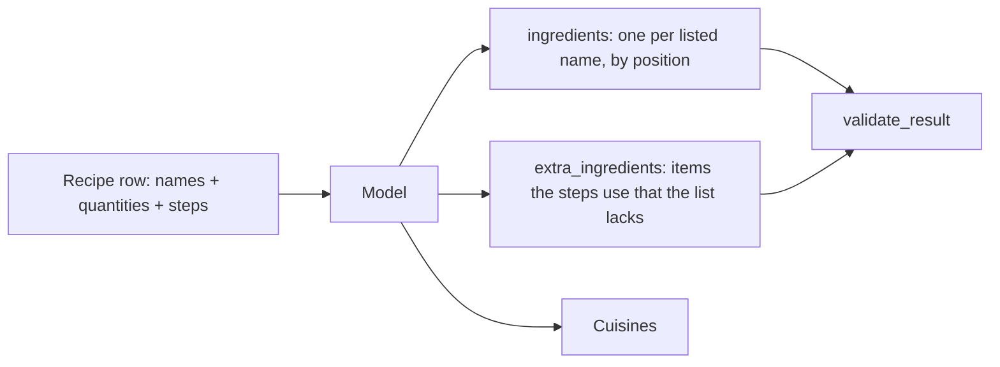

# Week of 10.28 to 11.04: Fixing the incomplete ingredient list in the Food.com augment step (Andrew)

## Summary
After the 200-recipe pilot we checked an assumption we had never tested: that each recipe's `ingredient_parts` list is complete. It is not, so the stage 2 model now also returns `extra_ingredients` for items the steps use that the list lacks. We also widened the cuisine list from 20 to 90 and cut the cap to 2 per recipe. Next come parameter experiments and a 20-recipe comparison of thinking on and off.

## PRs this week
| PR | What it did | State |
|---|---|---|
| [#17](https://github.com/andrewtclim/meal-prep-app/pull/17) | `clean.py`, tests, DECISIONS #23 to #25, concepts | Merged (merge commit) |
| [#18](https://github.com/andrewtclim/meal-prep-app/pull/18) | `augment.py`, tests, DECISIONS #26, concepts, `.env.example`; now also `extra_ingredients` | Draft, base retargeted to `main` |

## Session: 2026-10-29
### What we worked on and why
Paul and I talked over the pilot results. One of the points was that we use the ingredient list as the anchor for the model's answer, yet we had seen more quantities than ingredients. We did not know which list was incomplete, so before widening anything we checked it on real rows (no API cost). PR #17 had merged, so PR #18 was retargeted from the stacked branch to `main` first; with a merge commit nothing had to be replayed, so no rebase was needed.

**What the check found.** On the 212,846-row subset, 21% of recipes have as many quantities as names, 75% have more, and 4% have fewer. Sample rows made the cause clear:

| Field | Joe's Saute Onions |
|---|---|
| `ingredient_parts` (4) | olive oil, salt, butter, sugar |
| `quantities_raw` (5) | `1 -3` and four blanks |
| Steps | "Slice off the root and top ends of the onions, peel the onions..." |

The recipe is about onions, they are not in the list, and the first quantity is theirs. A rough keyword check (a staple word in the steps but in no ingredient name) flagged 54% of the "more quantities" group against 32% of the aligned recipes. The aligned group is the noise floor, since salt and water are often left off lists on purpose. So the real gap is about 21 points, and it is an estimate, not a measured miss rate.



### Key code
`pipelines/foodcom/augment.py` (schema)
```python
"extra_ingredients": {
    "type": "array",
    "items": {"name": string, "quantity": number|null, "unit": <UNITS enum>},
},
...
"required": ["ingredients", "extra_ingredients", "cuisines"],
```
The API now forces every answer to include the field. It is required so that `[]` means "the model checked and found nothing"; an optional field could also mean it skipped the check. Extras are keyed by `name` because they have no position in the source list.

`pipelines/foodcom/augment.py` (validator)
```python
extras = result.get("extra_ingredients", [])
if len(extras) > MAX_EXTRA_INGREDIENTS: ...
for e in extras:
    if name in EXTRA_BANNED_NAMES: ...   # salt, water
    elif name in taken: ...              # already listed, or listed twice
    problems += quantity_problems(f"extra '{name}'", e.get("quantity"), e.get("unit"))
```
The schema can only guarantee shape. The cap, the no-repeat rule and the salt/water rule depend on the recipe, so code checks them after the fact, and any problem goes into the one retry. `quantity_problems` is shared with listed ingredients so both follow the same null-with-`to_taste` rule. Repeat detection is an exact, case-insensitive match, so "garlic" still slips past "garlic cloves"; fuzzy matching could wrongly reject a real extra such as peanut butter, so exact is the safer start.

**Result of a 5-recipe test on the new schema ($0.0035).** All five validated on the first try and the model found every missing item we had spotted by eye: onions, feta, cooking spray, oil, taco seasoning mix, roasted peppers and squid. It never added salt or water. Open questions for the hand check: the model gave 3 onions for a source of `1 -3` where our rule says the midpoint, 2; and amounts for some extras (oil, 2 tbsp) cannot be checked against the quantities. Input rose by roughly 400 tokens per recipe, but the sample was biased toward long recipes, so the cost comparison waits for the matched 20-recipe pilot.

### Decisions and concepts
- DECISIONS #26 amendment (still Proposed): the finding, the six rules for extras, the tradeoffs. Paul has not signed off yet.
- CONCEPTS: [Anchor and completeness check](../docs/CONCEPTS.md#anchor-and-completeness-check)
- DATA_MODEL: `recipe_ingredient` will hold listed and extra rows with a proposed `is_extra` flag.

### Cuisines: 20 to 90 labels, at most 2 per recipe
Paul and I wanted something close to the 75 to 100 most common cuisines. We scanned Food.com's own tags (64 cuisine and region words exist, most with a few hundred recipes) and added the ones it lacks: italian, french, american, british, irish, mediterranean, israeli and others. `kosher` is a diet and `european`/`asian` are too coarse, so they are out. We merged near-duplicates the model cannot reliably separate (scottish and welsh into british, szechuan and hunan into chinese, lebanese and turkish into middle_eastern), but kept `cantonese`, and kept `italian` and `mediterranean` apart because the model sees the dish name and steps. The cap went from 3 to 2: in the pilot 97 of 200 recipes used two cuisines and only 3 used a third.

`pipelines/foodcom/augment.py`
```python
MAX_CUISINES = 2
CUISINE_KEYWORDS = {tag: tag.replace(" ", "_") for tag in _SAME_NAME_TAGS} | {
    "scottish": "british", "welsh": "british", "szechuan": "chinese", ...
}
```
Most Food.com tags now map to the same-named cuisine, so the baseline table is built from a list of names plus a handful of folded or renamed ones instead of 90 hand-typed pairs. Baseline coverage rose from 15.9% to 20.1% of the subset.

**API test.** The API accepted the 90-value schema (2 recipes, $0.0013). Input rose by exactly 677 tokens per call on both recipes, which is about +$14 direct or +$7 batch over 212,846 recipes. Two recipes also changed behaviour: Joe's onions went from `american` to `other`, and the spinach triangles from `greek, mediterranean` to `greek`. That is two recipes, an observation and not a measurement.

**The risk we have not measured:** near-neighbour confusion (labels covering almost the same food). The repeatability run and the hand check come next. CONCEPTS: [Label granularity and near-neighbour confusion](../docs/CONCEPTS.md#label-granularity-and-near-neighbour-confusion). DECISIONS #26 has a second amendment for this.

### Parameter experiments (about $0.03)
A learning step: what do the dials on a request do, on 5 messy recipes? We added optional `effort`, `thinking` and `max_tokens` arguments to `build_request_params` (defaults unchanged) and logged `thinking_tokens` per record.

| Experiment | Result |
|---|---|
| `max_tokens` 300 vs 4096 | 300 cut off all 5 first attempts (thinking ate the cap); 3 of 5 still failed after the retry; cost went up ($0.0043 vs $0.0039) because the retry resends the input |
| `effort` low / medium / high | cost $0.0039 / $0.0040 / $0.0049; thinking was 71 to 79% of output; `low` stays |
| Repeatability: `low` three times | 15 to 17 of 47 ingredient entries differ between identical runs, about the same as `medium` or `high` vs `low` (19 to 21); 4 of 5 recipes changed cuisine set at least once |
| `temperature` | the Python SDK has no such argument; sent via `extra_body`, the API returns 400 "temperature: Extra inputs are not permitted" (same for `top_p`) |

```python
def build_request_params(recipe, problems=None, *, effort=EFFORT, thinking=None, max_tokens=MAX_OUTPUT_TOKENS): ...
```
The defaults equal the production setting, so nothing changes for normal runs; experiments pass the dials in. The saved record gains `thinking_tokens` and `mode` for the later thinking-on versus thinking-off pilot.

What to take away: `max_tokens` is a safety limit, not a cost dial; the model's answers on messy recipes are noisy, so consistency has to come from the schema, validator, closed lists and prompt rules, and a hand check has to say which answers are right. The cuisine flips (`mediterranean`, `tex_mex`, `american`) are the near-neighbour confusion made visible. CONCEPTS: [Request dials](../docs/CONCEPTS.md#request-dials-max_tokens-effort-thinking-and-temperature).

## What we'd explain differently next time
I wrote "the ingredient list is the anchor" as a design assumption while already holding the stage 1 number that only 22% of lists match the quantities, and did not ask what the extras were. The check cost nothing and took minutes. The habit to keep: when a join key looks tidy, compare it with a second signal on a sample before building on it.
