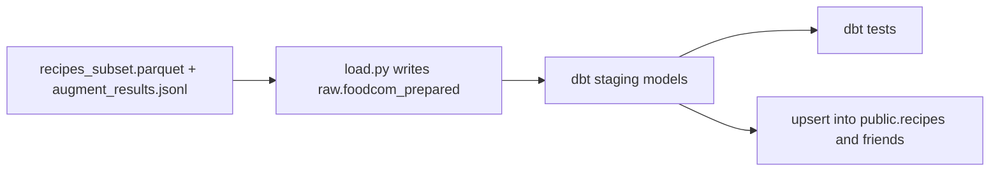
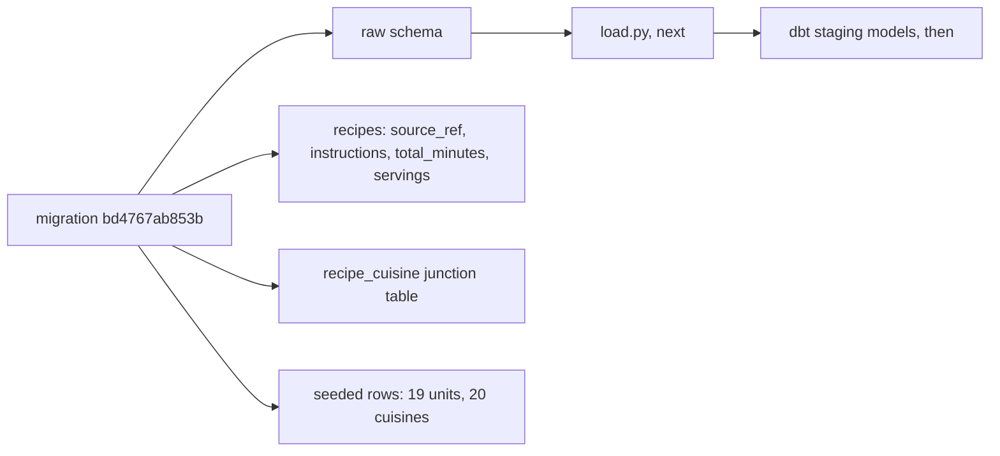
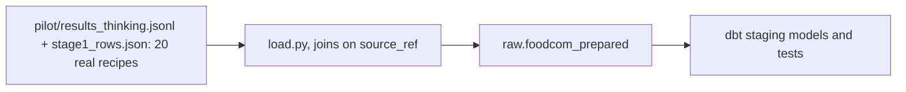
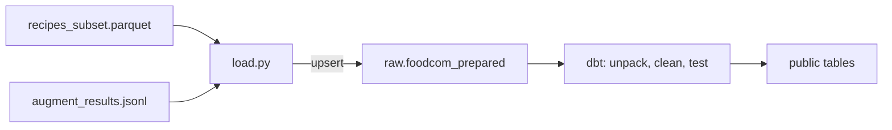
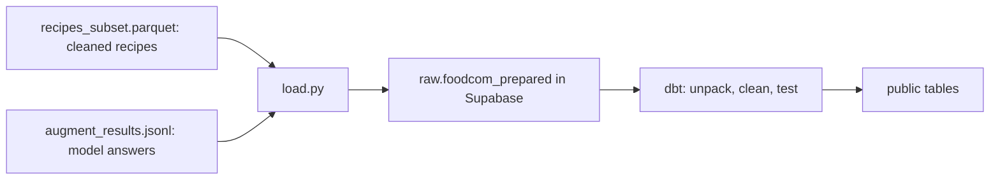
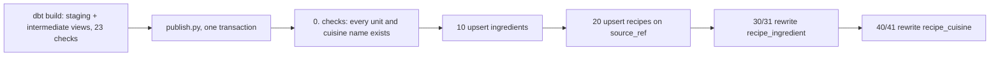

# Week of 10.28 to 11.04: dbt staging for Food.com (Paul)

## Summary
Started stage 3 of the Food.com pipeline: loading the cleaned and LLM-augmented recipes into Supabase with dbt. So far we checked what the live database is missing, and added dbt as a dependency in its own group. The migration, the loader and the dbt models come next.

## PRs this week
| PR | What it did | State |
|---|---|---|
| [#20](https://github.com/andrewtclim/meal-prep-app/pull/20) | Migration (`raw` schema, recipe source columns, `is_extra`, `recipe_cuisine`, units), `load.py` with tests, dbt dependency, DECISIONS #27 and docs | Open. Base is `feat/foodcom-augment` (PR #18), so the diff shows only this work; change the base to `main` after #17 and #18 merge |
| [#21](https://github.com/andrewtclim/meal-prep-app/pull/21) | dbt project, connection profile, `sources.yml`, `stg_recipes` and 8 tests, `DBT_*` in `.env.example`, dbt concepts | Open (draft). Base is `feat/dbt-staging` (#20), so the diff shows only dbt files; it depends on #20 for the `raw` table and must merge after #18 and #20 |
| (next) | Intermediate models (ingredients, cuisines), then the upsert into `public` | Not started |

## Session: 2026-10-29
### What we worked on and why
Andrew's stages 1 and 2 produce a cleaned recipe file and a file of LLM answers (units, quantities, cuisines). Stage 3 gets that data into Supabase. The path is: write the prepared data into a `raw` schema, let dbt build clean staging tables from it, test them, then upsert into the Alembic-owned `public` tables (DECISIONS #24).

Before writing anything we checked the real database instead of assuming. Connecting to the Supabase session pooler showed:
- Alembic is at `fe3310413886`, so both migrations are applied.
- Only the `public` schema exists. There is no `raw` schema.
- `recipes` has zero rows and only two columns, `recipe_id` and `recipe_name`.
- There is no `recipe_cuisine` table, so a recipe's cuisines have nowhere to go.

So the order is: migration, then `load.py` into `raw`, then dbt. dbt only runs SQL inside Postgres, so the data has to be in a table before it can transform anything.

We also found two things not on this laptop yet: the 200-recipe pilot results (`augment_results.jsonl`, which lives on Andrew's machine) and a clear plan for how many recipes fit in the free tier (DECISIONS #25 says the full 212,846 do not).

### Diagram


### Key code
`pyproject.toml`
```toml
transforms = [
    "dbt-core>=1.12.6",
    "dbt-postgres>=1.11.0",
]
```
`dbt-core` is the engine that compiles our SQL models and runs the tests. `dbt-postgres` is the adapter that knows how to talk to Postgres. It goes in its own `transforms` group, like `pipelines`, because the API Docker image installs with `--no-dev` and never needs dbt. Added with `uv add --group transforms dbt-core dbt-postgres`, which also updated `uv.lock`.

Committed on its own (`Add dbt-core and dbt-postgres in a transforms group`) so a reviewer can see the dependency change separately from the code that uses it.

### Decisions and concepts
- DECISIONS #15 (dbt for SQL transforms) already accepts dbt. A new entry for the `transforms` group is still to write (#27, Proposed), together with the choices below.
- CONCEPTS: a `dbt` entry is still to write, in the same PR as the first model.
- Open choices for the migration: seed `cuisines` and `units` in the migration or in dbt, and create the `raw` schema in Alembic or in dbt.

## Session: 2026-10-30
### What we worked on and why
Wrote the migration that gets Supabase ready for the Food.com load: `alembic/versions/bd4767ab853b_add_raw_schema_recipe_source_columns_.py`. It chains onto `fe3310413886` through `down_revision`, because the first two revisions are already applied and an applied file is never edited. We built it in four jobs, one at a time, and checked each before the next. It is **not applied yet**; we printed the SQL with `alembic upgrade fe3310413886:bd4767ab853b --sql` first, which needs no database connection.

### Where dbt is used (and where it isn't)
This migration does not use dbt. The split of tools is:
- **Alembic** builds the shelves (schemas, tables, columns). It runs once per change.
- **`load.py`** (next) writes the cleaned recipes joined with the LLM answers into `raw.foodcom_prepared`.
- **dbt** turns that one wide table into tidy staging tables (one row per recipe, per ingredient, per cuisine) and runs data tests on them (unique `source_ref`, only allowed units and cuisines).
- The final upsert into `public` is probably a small SQL or Python step, because dbt builds tables but does not do `INSERT ... ON CONFLICT` cleanly. To settle in the dbt PR.

`raw.foodcom_prepared` is not the untouched source. It is the cleaned subset plus the LLM output, so it can be rebuilt by rerunning `load.py` from `recipes_subset.parquet` and `augment_results.jsonl` (DECISIONS #24 amends #14).

### Key code
`alembic/versions/bd4767ab853b_...py`
```python
op.execute("CREATE SCHEMA IF NOT EXISTS raw")
op.add_column("recipes", sa.Column("source_ref", sa.BigInteger))
op.create_unique_constraint("uq_recipes_source_ref", "recipes", ["source_ref"])
```
`raw` is the folder where `load.py` writes. `source_ref` is the Food.com id, and the unique constraint is what lets a later `INSERT ... ON CONFLICT (source_ref)` update a recipe instead of duplicating it on a rerun (idempotency, DECISIONS #14). `add_column` does not make a column unique by itself, so the constraint is a separate call.

All four new columns are nullable, including `source_ref`. The table is empty today, so nothing forces this, but user-saved recipes share the table and have no Food.com id, steps or times. Postgres allows many `NULL`s under a unique constraint. `total_minutes` and `servings` are `Integer` and not `Text`; `instructions` is `Text`, which has no length limit and is no slower than `VARCHAR(n)` in Postgres.

```python
units = sa.table("units", sa.column("unit_name", sa.Text))
op.bulk_insert(units, [{"unit_name": name} for name in UNITS])
```
Seeds the 19 units (and, the same way, the 20 cuisines). These are the closed lists the LLM may answer with (DECISIONS #26), so every answer has an id to map to. Two things that went wrong in the first draft:
- `bulk_insert` takes a table object, not a string name.
- We first hardcoded `unit_id` values. The id column is an identity column, so Postgres would not know those ids were used, and the first unit added later would collide. We pass only the name.

`UNITS` and `CUISINES` are **copied** into the migration instead of imported from `pipelines/foodcom/augment.py`. A migration is a snapshot of what was done on one day. If it imported the lists, a later edit to `augment.py` would change what the same migration does on a fresh database, and the import would also need the `pipelines` dependency group, which Alembic does not install. The cost is two lists to keep in step; a test that compares them is a good follow-up.

```python
def downgrade() -> None:
    # delete seeded rows, drop recipe_cuisine, drop constraint and columns
    op.execute("DROP SCHEMA IF EXISTS raw CASCADE")
```
`downgrade()` undoes everything in reverse order, so an upgrade followed by a rollback leaves the database as it started. It deletes only the seeded names, not every row in `units` and `cuisines`. `CASCADE` is needed once `raw` holds `foodcom_prepared`, because a plain `DROP SCHEMA` fails on a non-empty schema. It is safe here because `raw` is downstream of the paid LLM calls: the paid output is in `augment_results.jsonl`, and the table is rebuilt by rerunning `load.py`. The real risk is losing that jsonl file (it is only on Andrew's laptop), which is a backup problem and not a migration problem.

### When to use downgrade
- To undo a migration you applied locally that had a mistake: roll back, fix the file, apply again. Test with `uv run alembic downgrade -1`, then `upgrade head`.
- To switch to a branch with different migrations.
- Not on production data: a downgrade deletes the columns and the data in them. On production a forward-fixing migration is usually safer.
- `uv run alembic current` shows which revision a database is on.

### Diagram


### Decisions and concepts
- Decided: the `raw` schema and the lookup seeds go in Alembic, not dbt, because `load.py` runs before dbt and Alembic already owns those tables.
- Open (not decided here): real ingredient-name normalization ("boneless skinless chicken breasts" to "chicken breast"). `clean.py` fixes the file's quirks; normalization is a modeling choice that will keep changing, so it belongs with dbt/the `ingredients` table, but it may not fit plain SQL. dbt only does `lower(trim(name))` for now. Roadmap row "Ingredient name normalization v1" has no owner.
- To write in this PR: DECISIONS #27 (Proposed) for the `transforms` group and the choices above, and CONCEPTS entries for dbt, seed (lookup) data, and identity columns.
- CONCEPTS (existing): [Database migration (Alembic)](../docs/CONCEPTS.md#database-migration-alembic), [Junction table](../docs/CONCEPTS.md#junction-table), [Deterministic vs idempotent pipelines](../docs/CONCEPTS.md#deterministic-vs-idempotent-pipelines)

## Session: 2026-10-31
### What we worked on and why
Andrew updated PR #18 after Paul's review, so we checked what changed and whether it affects the migration, then rebased our branch onto it. The plan for the rest of the day is to not wait for #17 and #18 to merge: build against data that is already committed.

### What changed in PR #18 and what it means for us
| Change in #18 | Effect on `feat/dbt-staging` |
|---|---|
| Cuisines grew from 20 to 90, at most 2 per recipe (DECISIONS #26 amendment) | The migration still seeds the old 20. The cuisine seeds wait for the final list; units are unchanged (19) |
| New `extra_ingredients`: items the model finds in the steps that the ingredient list lacks | `recipe_ingredient` needs a flag to tell them apart (DATA_MODEL.md proposes `is_extra`), and stage 3 must normalize extras the same way as listed ones |
| Saved results are keyed by `source_ref`, not `recipe_key` (raised in review) | `load.py` joins on `source_ref`. `recipe_key` is a position number that stage 1 can shift, so it must not be a join key. This matches the unique column we already added |
| Thinking vs no-thinking still open | Only affects the paid full run, not our work |

### Key idea: rebase
A branch is a chain of commits. `git rebase feat/foodcom-augment` replays our two commits on top of Andrew's latest commit, so the history is one straight line (his commits, then ours) and a reviewer of our PR sees only our work. Our commit ids changed (`09f2bc6` to `88b220f`, `42dca71` to `610b53d`) because an id depends on the parent commit.
- Alternative: `git merge`, which keeps history as it happened and adds a merge commit. Safer, noisier.
- Rule: never rebase commits others already have, because it rewrites their ids and forces a `git push --force`. Safe here because the branch was local only.
- If it goes wrong: `git rebase --abort`. If `uv.lock` conflicts, rerun `uv lock` instead of merging it by hand.
- Result: clean rebase, no conflicts, `uv run pytest` gives 79 passed.

### Working without waiting on #18
Andrew committed real data in the new format under `pipelines/foodcom/pilot/`: `results_thinking.jsonl` (20 model answers with extras, cuisines and `source_ref`) and `stage1_rows.json` (the 20 matching cleaned recipes). That is enough to build and test `load.py` and the dbt models end to end. Only three things really wait on Andrew: the final cuisine list, the thinking verdict and budget, and any further change to his output format. To keep the later rebase onto `main` clean, we do not edit his files (`augment.py`, `clean.py`, his docs entries) and copy any list we need.

Plan for the session, in order:
1. Split the migration: schema now, seeds in a later revision. Add `recipe_ingredient.is_extra`.
2. Apply the schema migration to Supabase and verify.
3. Seed the 19 units now; cuisines in a later revision once the list is final.
4. `load.py`: join the results and the cleaned recipes on `source_ref`, write `raw.foodcom_prepared`, test on the 20 pilot recipes.
5. dbt project, connection and `sources.yml`.
6. Staging models: `stg_recipes`, `stg_recipe_ingredients` (listed plus extras), `stg_recipe_cuisines`.
7. dbt tests: unique and not-null `source_ref`, `accepted_values` for units and cuisines, relationships.
8. Decide how the final upsert into `public` runs.
9. DECISIONS #27, CONCEPTS entries, ROADMAP rows.

Two PRs: A is the migration plus `load.py`, B is dbt.



### Step 1 done: the migration split and `is_extra`
We edited `bd4767ab853b` (still unapplied, so editing is allowed) instead of adding a second file yet:
- **Removed** the `CUISINES` list, the cuisine insert and its `downgrade()` delete. The cuisine list is still changing (90 labels in #18, open in DECISIONS #26), and a seed baked into an applied migration can't be edited. A later revision seeds the final list. A comment in the file says so.
- **Kept** the 19 units seed, since that list is unchanged.
- **Added** `recipe_ingredient.is_extra`.
- Fixed the docstring (`recipe_cuisine` now says 1 or 2 cuisines, matching `MAX_CUISINES = 2`).

`alembic/versions/bd4767ab853b_...py`
```python
op.add_column(
    "recipe_ingredient",
    sa.Column("is_extra", sa.Boolean, nullable=False, server_default=sa.false()),
)
```
`is_extra` marks ingredients the LLM found in the steps that Food.com's list lacks (for example oil). The pantry check needs to know which rows are listed and which were inferred, because inferred ones are less certain. `NOT NULL DEFAULT false` is the truthful default: every existing row, and every user-saved recipe, is a listed ingredient, and a three-valued boolean (true, false, null) would force every query to handle null. Tradeoff: a flag column is cheaper than a separate table, but it mixes two kinds of row in one table, so any query that must not count extras has to filter on it.

**What `is_extra` means, with a real row.** Food.com's ingredient list is often incomplete (about 75% of recipes have more quantities than names). Andrew's step has the model read the steps and add items the list lacks. Both kinds become rows in `recipe_ingredient`, and `is_extra` tells them apart because a listed ingredient came from the recipe author (reliable) while an extra was inferred by a model (usually right, sometimes invented). Real example from `pipelines/foodcom/pilot/results_thinking.jsonl`, `source_ref` 47403, "Black Pepper Pork with Ramen Noodles". The source list has five items and no noodles, although the title and the steps ("cook noodles in 2 qts boiling water") use them:

| Ingredient | Amount | `is_extra` | Where it came from |
|---|---|---|---|
| boneless pork chop | 1 lb | false | Food.com list |
| garlic | 2 clove | false | Food.com list |
| onion | 1 piece | false | Food.com list |
| broccoli florets | 2 cup | false | Food.com list |
| black pepper | to taste | false | Food.com list |
| ramen noodles | 1 package | **true** | model, from the steps |
| vegetable oil | 2 tbsp | **true** | model, from the steps |
| stir-fry sauce | 2 tbsp | **true** | model, from the steps (steps say "Stir-Fry Sauce") |
| sesame oil | to taste | **true** | model, from the steps |

The app can then show "also needs vegetable oil" without a plan depending on it, and a query that must not count inferred items can use `WHERE NOT is_extra`. The cost is that any such query has to remember the filter.

Checked without touching the database: `alembic upgrade fe3310413886:bd4767ab853b --sql` and the matching `downgrade --sql` both print the expected statements, and `ruff` passes. Not applied to Supabase yet. Applying changes the live database, so Paul runs `uv run alembic upgrade head` after reading the SQL.

### Applied to Supabase (Paul ran `uv run alembic upgrade head`)
No errors. Verified with read-only queries against the live database:

| Check | Result |
|---|---|
| `alembic_version` | `bd4767ab853b` |
| `raw` schema | exists |
| `recipes` columns | `source_ref` bigint, `instructions` text, `total_minutes` integer, `servings` integer, all nullable |
| `uq_recipes_source_ref` | exists |
| `recipe_ingredient.is_extra` | boolean, `NOT NULL`, default `false` |
| `recipe_cuisine` | exists |
| `units` / `cuisines` rows | 19 / 0 (cuisines wait for the final list) |

Because this revision is now applied, it is frozen: any change goes in a new revision (the cuisine seeds will be one).

### Primer: what `load.py` is and why we need it
Stages 1 and 2 leave two local files: `recipes_subset.parquet` (cleaned recipes, from `clean.py`) and `augment_results.jsonl` (the model's amounts, units, extras and cuisines, from `augment.py`, keyed by `source_ref`). dbt only runs SQL inside Postgres and cannot see files on a laptop, so something has to copy the data in first. `load.py` is that step, and `raw` is where it writes.



What it does: (1) read both files, (2) join on `source_ref` and skip records whose `status` is not `ok`, counting them, (3) check required fields and stop with a clear error if one is missing, (4) upsert each row into `raw.foodcom_prepared` keyed on `source_ref`, (5) report loaded, updated and skipped counts.

Design choices and the alternative for each:
- **Join on `source_ref`, not `recipe_key`.** `recipe_key` is a position number from `clean.py` that can shift if stage 1 changes, so joining on it can attach answers to the wrong recipe with no error. This is the bug Paul caught in the PR #18 review.
- **Upsert, not insert.** `INSERT ... ON CONFLICT (source_ref) DO UPDATE` leaves the table in the same state however many times it runs (idempotency, DECISIONS #14). A plain insert duplicates every row on a rerun.
- **Its own script.** Not dbt, because dbt transforms data already in the database and does not read local files. Not `augment.py`, because that step costs money per call and loading should be free and testable. Not a manual CSV import, which is not in git, not testable and not idempotent.
- **Model answer stored as `jsonb`** (proposed, Paul to confirm). Andrew's answer shape has changed twice. A flattened load would break each time and need a migration, while `jsonb` copies it unchanged and dbt unpacks it in SQL. Cost: a misspelled field name only shows up when dbt runs.

Shortcuts and limits: `raw` is a rebuildable copy, so dropping and reloading is cheap. The full load (212,846 rows) waits on the database size question in DECISIONS #25, so we test on the 20 pilot recipes first. A row-by-row insert is slow at 200k rows, so the full version should batch; the first version stays simple.

### Primer: what `load.py` is and why we need it
`load.py` copies the finished Food.com data from local files into Supabase. It is the "L" in ELT. Andrew's scripts write only to local files (`recipes_subset.parquet`, `augment_results.jsonl`) because the LLM step costs money and runs on a laptop (DECISIONS #24), and dbt can only read what is already inside Postgres, so `load.py` is the one step that touches both.



What it does, in order:
1. Reads both files.
2. Joins them on `source_ref`, Food.com's own id. `recipe_key` is a position number that stage 1 can shift, so it is not a safe key.
3. Skips any record whose `status` is not `"ok"` and counts the skips, so a failed paid call never becomes a half-empty recipe.
4. Writes one row per recipe into `raw.foodcom_prepared`, with the model's answer in a `jsonb` column.
5. Upserts (`INSERT ... ON CONFLICT (source_ref) DO UPDATE`), so a rerun updates rows instead of duplicating them (idempotency, DECISIONS #14).
6. Later: writes a `pipeline_runs` row (rows loaded, duration, status).

Why a separate script, and not inside `augment.py`: reloading the database can then be repeated without paying for another model call, and a load that dies halfway (a dropped connection) just reruns.
Why Python and not dbt: dbt only transforms data already in the database. Its "seed" feature is for small CSV lookup tables, not 200k recipes with nested lists, and it cannot read parquet.
Why `raw` and not straight into `public`: a bug in the unpacking would corrupt live tables. Landing in `raw` lets us inspect it, test it with dbt and rebuild `public` from it as often as we like.
Tradeoff: more code to maintain, and any mismatch between the file's shape and the table's shape surfaces at load time.

Interview question: how do you make a data load safe to rerun, and how do you know what you loaded? Upsert on a natural key, skip and count bad rows, and a run log.

Design choices to confirm before writing it: store the model's answer as `jsonb` (survives Andrew changing the output shape; dbt does the unpacking; a typo in a field name only shows up when dbt runs) versus flattened columns, and upsert versus full replace (recommended: upsert).

### Full replace or upsert for `raw`? (a correction)
Question from Paul: is a full replace more compute than an upsert? Not necessarily, and the first recommendation (upsert) overstated the case.
- **Compute.** A full reload via `TRUNCATE` plus a bulk `COPY` writes each row once on the fast path. An upsert checks every row against the unique index, and a plain `DO UPDATE` rewrites unchanged rows too, so it is usually slower for a full reload. An upsert only saves work if it can skip unchanged rows.
- **Space.** Each updated row leaves a dead copy until vacuum, so reruns can bloat the table. That matters on the 500 MB free tier (DECISIONS #25).
- **Both are idempotent**, so that does not decide it.
- **Real differences:** a full replace also removes rows that vanished from the source and is atomic inside one transaction (cost: a brief lock during `TRUNCATE`); an upsert allows incremental or batched loads.
- **Rows that others point at.** Nothing points at `raw.foodcom_prepared`, so replacing it is harmless. `public.recipes` has an identity `recipe_id` that `user_recipe`, ratings and pantry rows will reference; a full replace there would reassign ids and break those links. So the final write into `public` must be an upsert.
- **Updated recommendation:** full replace for `raw`, upsert for `public`. Exception: if loading in batches or adding recipes incrementally matters, use upsert for `raw` too.

### Step 4 done: `pipelines/foodcom/load.py` (full replace)
Decided: full replace for `raw.foodcom_prepared` and `jsonb` for the model's answer. Built with `--dry-run` and `--pilot` flags and tests that need no database.

`pipelines/foodcom/load.py`
```python
def read_results(path):  # -> (records keyed by source_ref, Counter of skips)
    ...
    if record.get("status") != "ok":            skipped["status not ok"] += 1
    elif record.get("source_ref") is None:      skipped["no source_ref"] += 1
    elif validate_answer(record.get("result")): skipped["bad answer shape"] += 1
    else:                                       records[int(record["source_ref"])] = record
```
Only good records survive, and every skip is counted by reason, so a failed paid call never becomes a half-empty recipe and nothing is dropped silently. The results file is append-only, so if a `source_ref` appears twice the later line wins.

```python
wanted = recipes[recipes["source_ref"].isin(results)]
stats["results without a recipe"] = len(results) - len(wanted)
```
The results file decides which recipes load, so the same code handles the 20-recipe pilot and the full run. A result whose recipe is missing from the cleaned file means stage 1 and stage 2 are out of step, so it is counted and reported. We read recipes from the parquet and not from the pilot's `stage1_rows.json`, because the pilot file has no `total_minutes`.

```python
with conn.transaction():
    conn.execute(CREATE_TABLE_SQL)
    conn.execute(f"TRUNCATE {TABLE}")
    with conn.cursor() as cur, cur.copy(f"COPY {TABLE} (...) FROM STDIN") as copy:
        for row in rows:
            copy.write_row(row)
```
One transaction: if any step fails, Postgres rolls back and the old data stays. `COPY` is Postgres's bulk-load path, faster than one `INSERT` per row. `TRUNCATE` keeps the table's shape, so if its columns ever change the table must be dropped by hand first (a drop would also fail while dbt views depend on it). The loader owns the table, not Alembic: Alembic created the `raw` schema, but `raw.foodcom_prepared` is rebuildable (DECISIONS #14, #24).

The `answer` column is `jsonb`: it keeps `ingredients`, `extra_ingredients` and `cuisines` whole, so dbt does the unpacking and a change in Andrew's output shape does not break the load. The load refuses to run when nothing would load, so a bad path can never empty the table.

Tests (`tests/pipelines/test_load.py`, 7 tests, no database): skip and count bad records, last good record wins, only recipes with results load, orphan results are counted, row tuples match `COLUMNS`, missing numbers stay `None`. Full suite: 86 passed; `ruff` clean. Dry run on the pilot: 20 results to 20 rows.

Not done on purpose: images, description and the nutrition columns are not loaded. They are not needed for the recipe and ingredient tables, and can be added to the loader when something needs them.

### File walkthrough
We went through each changed file to check we can explain it. Order: `pyproject.toml` and `uv.lock`, the migration, `load.py`, its tests, this post.

**1. `pyproject.toml` and `uv.lock`.** `pyproject.toml` is the shopping list (we want dbt 1.12 or newer); `uv.lock` is the receipt (exactly what was installed, with a hash for each download). Two packages grew the lock by 1,022 lines because each one has its own dependencies, and so do those. Paul's own summary, confirmed correct: `uv lock` reads the requirements in `pyproject.toml` and resolves the dependencies of all the other packages to meet them, picking one version of each that satisfies everything at once (it reports a conflict if none exists). `uv sync --locked` installs exactly the locked versions and fails if the two files disagree, which is what Docker and CI use. The `transforms` group is separate so the Docker image (`--no-dev`) never carries dbt. CI installs `--group pipelines` only today, so it needs `--group transforms` when dbt tests move into CI.

**3. `load.py` (parts 1 to 3 of 4).**
- *Constants and table shape.* Two inputs (cleaned parquet, results file) and one destination, `raw.foodcom_prepared`. `source_ref` is the primary key, the list columns and the whole model answer are `jsonb`, and `loaded_at` is filled in by the database so `load.py` never writes it.
- *Helpers.* `to_list` exists because pandas returns list columns as numpy arrays and `json.dumps` cannot write them; `to_int` handles pandas' own missing marker. `validate_answer` is a shape check only (three keys exist and are lists).
- *Where units are checked.* Paul asked whether a bad unit is caught elsewhere, and it is: in `augment.py` (the schema's enum plus `validate_result`, when the answer is made) and again by a dbt `accepted_values` test (on the data as it sits in the database). `load.py` deliberately does not repeat it, because that would be a third copy of the list to keep in step, and loading should only move data. The dbt test is still worth it because `augment.py` checked against the lists as they were that day, and the lists have changed (cuisines 20 to 90, `british_irish` replaced by `british` and `irish`), so an older results file can hold values that are no longer allowed.
- *Reading results.* JSON Lines, one record per line. Each record passes three gates in order (status ok, has a `source_ref`, answer has the right shape) and a failure is counted by reason. Usable records are keyed by `source_ref`; a repeated key means a rerun, and the later (newer) line wins. A `Counter` is a dict that counts.
- Check three points in time: a shape check at load, the value check when the answer is made, the value check again on what is in the database. Each catches something the others can miss.

**3 (continued). `load.py` part 4: building and writing the rows.**
- `build_rows` keeps only recipes whose `source_ref` has a usable result, an inner join, so the results file decides what loads (the same code serves the pilot and the full run). `results without a recipe` should be zero; if not, stage 1 and stage 2 are out of step.
- Each recipe becomes one tuple in `COLUMNS` order. List columns and the answer go through `json.dumps` and Postgres stores the text in the `jsonb` columns; a missing category becomes `None`, which is SQL `NULL`.
- `replace_table`: `conn.transaction()` makes the steps succeed or fail together, so a failure during `COPY` also undoes the `TRUNCATE` and the old data stays. `TRUNCATE` plus `COPY` is the full replace, faster than one `INSERT` per row. `CREATE TABLE IF NOT EXISTS` makes the first run work with no setup. Limit: `TRUNCATE` keeps the old shape, so a new column means dropping the table by hand first.

**4. `tests/pipelines/test_load.py`.** Seven tests, none touching a database, so they run in CI in about a second: conversion helpers, the shape check, skip-and-count, last-good-record-wins, the inner join and orphan count, row tuples matching `COLUMNS` with JSON that round-trips, and missing numbers staying `None`. Two small helpers (`record()`, `make_recipes()`) build fake data. Not covered: `replace_table` and `main`, which need a real database; the real pilot load is their check, and a throwaway Postgres in CI is the usual later fix.

**Worked example: `test_read_results_last_good_record_wins`.** `model_note` is not a real field. `record()` accepts extra keyword arguments (`**extra`) and copies them into the fake record, so `record(1, model_note="old")` and `record(1, model_note="new")` are two records for the same recipe that differ only by a label. Without the label they would be identical, and a test that compares identical things passes even if the code picks the wrong one. Rule of thumb: when testing "which one wins", make the candidates visibly different.

With a file that has two lines for `source_ref` 47403 (an older and a newer answer), `read_results` stores line 1 under key 47403, then line 2 overwrites it, because a dict holds one value per key. The "last wins" rule needs no extra code. It would break if someone changed the code to skip keys already stored (`if key not in records`): the pipeline would keep the old answer, ignore the paid rerun, and nothing would crash. The label makes the test fail in that case.

**Reading the run command: `uv run --env-file .env python -m pipelines.foodcom.load --pilot`.**
- `uv run` runs the command inside the project's `.venv` with the locked packages, no activate step.
- `--env-file .env` loads each `NAME=value` line of `.env` into the program's environment, so `DATABASE_URL` reaches the script without the password being in code. `main()` reads it with `os.environ["DATABASE_URL"]`; forgetting the flag gives `KeyError: 'DATABASE_URL'`.
- `python -m pipelines.foodcom.load` runs the module by its dotted name, which starts from the repo root so `from pipelines.foodcom...` imports work. Running `python pipelines/foodcom/load.py` would put that folder on the path instead and could break them.
- `--pilot` is defined by `parser.add_argument` and swaps the results path to the committed 20-recipe file; without it the default is `data/interim/augment_results.jsonl`, which is not on this machine. The `if __name__ == "__main__": main()` block is what lets `python -m` start the script.
- Where `--pilot` comes from: it is not a Python or uv option; we defined it in `main()` with `parser.add_argument("--pilot", action="store_true")`. `argparse` (standard library) reads the words after the command and turns them into variables; `store_true` means a switch with no value, `args.pilot` is `True` if typed and `False` if not. Then `results_path = args.results or (PILOT_RESULTS_PATH if args.pilot else RESULTS_PATH)` picks the input file. The pilot file is `pipelines/foodcom/pilot/results_thinking.jsonl`, committed by Andrew in PR #18 for his thinking vs no-thinking comparison (20 real recipes in the current format). The full `data/interim/augment_results.jsonl` is git-ignored and not on this machine. `--help` lists every option.
- What "pilot" means: a small trial run of the same code before the paid full run, to measure cost per recipe, check answers pass validation, and look at accuracy by eye. Andrew's runs (DECISIONS #26): a 3-recipe test (showed the cost estimate was off about 2 times), a 200-recipe pilot (all passed validation; superseded because it used the old schema), and a 20-recipe thinking vs no-thinking comparison. The last one is what is committed in `pipelines/foodcom/pilot/`: `results_thinking.jsonl` (what `--pilot` reads), `results_nothinking.jsonl`, `stage1_rows.json` (the cleaned rows for those 20), and a review CSV and notebook. The 20 were picked to cover hard cases (a stratified sample), so they test that the pipeline works but say little about how the full dataset will look.
- Safe order: `--dry-run` first (builds rows, prints the report, never connects), then the real load, then a second run to confirm the row count stays at 20.

### Pilot load ran (Paul ran it twice; checked with read-only queries)
| Check | Result |
|---|---|
| Rows in `raw.foodcom_prepared` after two runs | 20 rows, 20 distinct `source_ref`, so the rerun did not duplicate (full replace is idempotent) |
| Listed ingredients vs the answer's `ingredients` | 0 of 20 recipes differ in length, so the model answered once per listed ingredient everywhere |
| Recipes with at least one extra | 11 of 20 |
| `loaded_at` | filled in by the database, identical across rows because one transaction wrote them |

Sample rows: 47403 "Black Pepper Pork with Ramen Noodles" has 5 listed ingredients and 4 extras, cuisine `chinese`; 71222 "Mama's Lasagna" has 8 and 2 extras, `italian`; 14296 "Cherokee Casserole" has 11 and 2 extras, `native_american` and `american`. Also, 30525 (smoked salmon rolls) got `other`, a reminder that the model's cuisine labels still need the hand check.

### PR #20 opened, then PR B1: the dbt project (branch `feat/dbt-project`, stacked on #20)
PR #20 is open as a draft with base `feat/foodcom-augment`. gh is not logged in on this machine and the repo page could not be fetched, so we checked what CI runs locally instead: `ruff` clean, 86 tests pass, `uv lock --check` clean. PR B is split in two: B1 is the project files plus `stg_recipes` and its tests, B2 is the ingredient and cuisine models and then the upsert. The difficulty by piece: project files easy, `stg_recipes` easy, unpacking the JSON into one row per ingredient medium, tests easy, the upsert hard (a design choice first), dbt in CI medium.

**`dbt/dbt_project.yml`, line by line.** The project's front page: what it is called, which connection to use, where the SQL lives and what to do with it.
```yaml
name: warehouse
version: "0.1.0"
profile: warehouse
model-paths: ["models"]
models:
  warehouse:
    staging:
      +materialized: view
```
- `name`: a generic label, so the app name is not in module names (DECISIONS #13). `version` is required by dbt and unused.
- `profile`: a pointer to the connection named `warehouse` in `profiles.yml`; the connection details are not in this file. A missing profile stops dbt loudly.
- `model-paths`: where the model files live (`dbt/models/`). A model is one `.sql` file holding one `SELECT`.
- The `models:` block reads like a path: settings for models, in the project named `warehouse` (matches `name:`, not the profile), in the folder `models/staging/` (matches the folder), build as a view. A `+` marks a dbt setting and not a folder. If `name:` changed but `models: warehouse:` did not, dbt would only warn about unused config and the settings would silently stop applying; a wrong profile name fails loudly.
- A view is a saved query that holds no data of its own, so it takes no space (the free tier is tight, DECISIONS #25). Staging models are just a cleaned lens on `raw`. The tradeoff is the query reruns on every read.

**`dbt/profiles.yml` and the double curly brackets.** The profile `warehouse` is the connection that `profile: warehouse` points to; dbt's Postgres adapter does not accept a `DATABASE_URL`, so the host, port, user, password and database name come from five variables (`DBT_HOST`, `DBT_PORT`, `DBT_USER`, `DBT_PASSWORD`, `DBT_DBNAME`) set in the git-ignored `.env`. The user on Supabase's pooler is `postgres.<project-ref>`, not just `postgres`. `schema: staging` is where dbt builds the views; dbt creates it if missing.

The `{{ ... }}` is Jinja, the templating language dbt uses: dbt runs the code inside and substitutes the result before reading the file. `host: "{{ env_var('DBT_HOST') }}"` becomes the real host. `env_var('DBT_PORT', '5432')` takes a default as its second argument. `| as_number` is a Jinja filter (the `|` passes a value to a function): environment variables are text and the port must be a number. The quotes are YAML's. The same brackets appear in SQL models: `{{ source('raw', 'foodcom_prepared') }}` becomes the real table name, and `{{ ref('stg_recipes') }}` names another model and tells dbt to build it first. A second kind, ``, holds logic such as `` and ``. Why dbt does this: it lets a file hold values that change (a secret, a table name) without hardcoding them, which is also why `profiles.yml` is safe to commit: it contains the names of the variables, not their values.

**Renaming the project (a mistake worth keeping).** Paul changed `name:` in `dbt_project.yml` to `meal-prep-app`. Three problems: dbt project names may contain only letters, digits and underscores, so hyphens are likely rejected (`meal_prep_app` would be valid); the `models:` block still said `warehouse:`, and since that key must equal `name:`, dbt would silently stop applying the `staging` settings; and DECISIONS #13 says to keep the app name out of package and module names so a rename is cheap (`meal-prep-app` is the repo name, not the app name). The `profile:` line is a separate pointer to `profiles.yml` and is unaffected. Fix: keep `name: warehouse`, or rename in both `name:` and the `models:` key with underscores.

Tested instead of guessed, with `dbt parse` on a throwaway copy in `/tmp` (dummy connection variables, repo untouched). With `name: meal-prep-app` dbt refuses to start: `at path ['name']: 'meal-prep-app' does not match '^[^\d\W]\w*$'`, a name must start with a letter or underscore and then use only letters, digits and underscores. With `name: meal_prep_app` and `models: warehouse:` unchanged, dbt parses but only warns: `Configuration paths exist in your dbt_project.yml file which do not apply to any resources. ... - models.warehouse.staging`. That is the quiet failure: the build would run but `+materialized: view` would apply to nothing, so a rename must change `name:` and the `models:` key together. Lesson: when unsure whether a tool accepts something, run it on a copy and read the message.

**First `dbt debug` run: two errors, two causes.** `dbt debug` is dbt's "does it work" check: it validates `dbt_project.yml`, validates `profiles.yml` and then really connects to the database.
1. `dbt_project.yml [ERROR invalid]`: the name was still `meal-prep-app` (hyphens are not allowed).
2. `could not translate host name "<the host part>" to address`: the five `DBT_` lines in `.env` still held the stand-in text from the instructions, `<the host part>` and so on. The angle brackets are also why uv warned `Failed to parse environment file ... at position 5`. The error message itself showed the placeholder, which is how we spotted it; a quick check (length of each value and whether it still contains `<` or `>`, without printing any secret) confirmed it for `DBT_HOST`, `DBT_USER` and `DBT_PASSWORD`.
Lessons: replace every placeholder, with no angle brackets or quotes; the value for `DBT_PASSWORD` must be the real password and not the URL-encoded form that appears inside `DATABASE_URL` (`%40` is `@`); `dbt debug` prints the host and user, so read the output before sharing it. The profile part passed (`profiles.yml file [OK found and valid]`), so the structure of the file was right.

**Second `dbt debug` run: connection works.** After replacing the placeholders, `Connection test: [OK connection ok]`: dbt reached Supabase through the pooler with the five `DBT_` variables. One check still failed, the same name error (`name: meal-prep-app`), which is a project file problem and not a connection problem. `dbt debug` checks each thing separately, so one failure does not hide the others; read all the lines, not just the last. The output shows the Supabase project ref inside the user name. It is an identifier and not a password, but worth a glance before sharing output.

**Naming decision: project `recipe_transforms`, connection `warehouse`.** Paul pointed out that using `warehouse` for both the project name and the profile name is confusing, and he is right: they are two different things (the project is the folder of SQL and settings, the profile is the database connection) that only matched because we typed the same word twice. The rules are: the project name uses only letters, digits and underscores; `name:` and the key under `models:` are the same word; `profile:` matches the top key in `profiles.yml`. So the two names can differ freely. Chosen: `name: recipe_transforms` (and `models: recipe_transforms:`), which says what the project does and keeps the app name out (DECISIONS #13), and the connection stays `warehouse`. The alternative was to rename the connection (for example `supabase`) in `profile:` and the top key of `profiles.yml`.

**Why `--project-dir dbt --profiles-dir dbt`.** By default dbt looks for `dbt_project.yml` in the current folder (and parents) and for `profiles.yml` in the current folder and then in a hidden `~/.dbt/`. Our project lives in a `dbt/` subfolder (DECISIONS #24) while commands run from the repo root (where `pyproject.toml` and `.env` are), so dbt would find nothing; the flags say where to look. Ways to avoid typing them: `cd dbt` (but then `.env` is `../.env`), `DBT_PROJECT_DIR` and `DBT_PROFILES_DIR` in `.env` (less obvious to teammates), or a wrapper such as a `Makefile` (one more file). We keep the explicit flags: nothing is hidden and CI can use the same command.

**Files dbt writes that must stay out of git.** `dbt/.user.yml` (an anonymous id for dbt's usage statistics, created on the first command), `dbt/target/` (compiled SQL and run results), `dbt/logs/` and `dbt/dbt_packages/`. None hold secrets, but they are machine-specific and regenerated. Added to `.gitignore`. A check with `git status` found one more: dbt writes `logs/` relative to the folder it is run from, which is the repo root, so a stray `logs/` appeared there and needs its own `.gitignore` line (`target/` is relative to the project, so `dbt/target/` is right). `git check-ignore -v <path>` shows which rule ignores a path.

**Same mistake again, caught by reading the file.** After renaming the project to `recipe_transforms`, the `models:` key still said `warehouse:`. dbt would only warn ("unused configuration paths") and `+materialized: view` would apply to nothing. Whenever `name:` changes, the `models:` key changes with it.

**`dbt debug` passes: `All checks passed!`.** It validated the project file, the profile and a real connection. A pass does not mean everything is right: it did not catch the stale `warehouse:` key under `models:` (only a warning at parse time) or the untracked `logs/` folder. `git status` and reading the file did.

**Step: `dbt/models/staging/sources.yml`.** A source tells dbt about a table it did not build, here `raw.foodcom_prepared`, written by `load.py`. Declaring it lets models read it with `{{ source('raw', 'foodcom_prepared') }}` instead of a hardcoded name, so dbt can show where data comes from, rename the table in one place, and test the source itself. In the file, `name: raw` is the source's name (first argument of `source()`), `schema: raw` is the database schema (same word, separate setting), each entry under `tables:` is the second argument, `description` is documentation dbt can render, and `data_tests` are checks run by `dbt test` (`unique` and `not_null` on `source_ref`, `not_null` on `answer`). The tests repeat what the primary key enforces, but on the table as dbt sees it, and a test is what keeps failing visibly if the table is ever recreated without that constraint.

**`sources.yml`, explained simply.** A source is a table dbt did not build (`raw.foodcom_prepared` was made by `load.py`), and `sources.yml` introduces it. Kitchen picture: a model is a dish, a source is an ingredient delivered from outside, and `sources.yml` is the delivery list. Why not hardcode `raw.foodcom_prepared` in SQL: the name would be repeated in every model; with `{{ source('raw', 'foodcom_prepared') }}` a rename is one change, dbt can draw where data comes from, and it can test the source itself.
- `version: 2` is the file format, never changes.
- `name: raw` is the source's label (first word in `source('raw', ...)`); `schema: raw` is the real database schema. Same word, separate settings: a source named `food_data` with `schema: raw` would be read as `source('food_data', ...)` and still come from the `raw` schema.
- Each entry under `tables:` is a real table name and the second word in `source()`.
- `description` is documentation only; dbt can render it as a website. `>` starts a paragraph that continues on the next lines.
- `data_tests` under a column: `unique` and `not_null` run with `dbt test`. dbt writes a `SELECT` that finds rows breaking the rule and the test fails if it finds any. `source_ref` is already a primary key, but the test still matters: if the table is ever recreated without the key, the database stops protecting us and the test fails visibly; it also documents the rule and will run in CI.
Nothing builds from a source alone; it matters when `stg_recipes.sql` uses it and when `dbt test` runs.

**Too many matching names, and the fix.** Paul asked why the same words keep appearing as labels. The reuse is real: `raw` was the source label, the schema in `sources.yml`, the first word of `source('raw', ...)` and the Postgres schema itself; `staging` is both a folder and a schema; `warehouse` is the connection. In dbt the folder, schema and label often line up on purpose, but while learning you cannot tell whether a word is a label we chose, a real database name or a folder. Rule of thumb for reading a dbt file: a name under `name:` is something we define; a name under `schema:`, a table or a file name is a real thing in the database or on disk; a name inside `{{ }}` is a reference to one of those. We gave the source label its own word: `name: foodcom`, `schema: raw`, table `foodcom_prepared`, so models read `{{ source('foodcom', 'foodcom_prepared') }}` and `raw` appears only where it is the real schema. `staging` stays, since folder and schema are meant to line up.

**First `dbt parse` on the project.** `dbt parse` reads every file and reports mistakes without touching the database. It passed; the only warning was `models.recipe_transforms.staging` having nothing to apply to, which is expected until the first model exists. The `sources.yml` file did not exist when first asked about: the content had been shown in chat but not created. A file shown in chat is not a file on disk; check with `git status` or the file tree.

### Docs updated for this PR (CLAUDE.md: docs change in the same PR as the code)
- **DECISIONS #27 (Proposed):** stage 3 split by tool. Alembic creates the schema, columns, `is_extra`, `recipe_cuisine` and the units; `load.py` replaces `raw.foodcom_prepared` (loader owns that table); dbt is in a `transforms` group; the final write into `public` is an upsert because other tables will reference `recipe_id`. Open inside it: how the upsert runs, and real ingredient-name normalization.
- **DATA_MODEL.md:** `is_extra`, the new `recipes` columns and `recipe_cuisine` are now created (the text said "not created yet"); `raw` for Food.com holds prepared data, not the untouched file.
- **ROADMAP.md:** the `raw` load row and the dbt row are Paul's and in progress, plus a Replans line.
- **CONCEPTS.md:** [Seed (lookup) data in a migration](../docs/CONCEPTS.md#seed-lookup-data-in-a-migration), [Identity column](../docs/CONCEPTS.md#identity-column), [jsonb](../docs/CONCEPTS.md#jsonb), [Full replace vs upsert](../docs/CONCEPTS.md#full-replace-vs-upsert), [Git rebase vs merge](../docs/CONCEPTS.md#git-rebase-vs-merge). The dbt entry waits for PR B, when the first model exists.
- Numbering risk: #27 is the next free number on this branch; if Andrew's PR also adds one, renumber ours before merging.

### Decisions and concepts
- DECISIONS #27 (Proposed), see above.
- Process decision: build against the committed pilot data instead of waiting for #18 to merge.
- Decided: full replace for `raw`, `jsonb` for the answer, loader owns the raw table.
- CONCEPTS (to write in this PR): upsert / idempotent load.
- Decided: `is_extra` is `NOT NULL DEFAULT false` (see above).
- DATA_MODEL.md still says the flag is "proposed, not created yet"; update it in the PR that applies this migration.
- CONCEPTS (to write in this PR): rebase vs merge, join on a stable key (`source_ref` vs a position number).
### Session: closing out PR #20 after Andrew's review (2026-11-04)
Andrew's review of #20 found schema drift: after my review of #18 he changed the model's answer from `cuisines` (a list) to `cuisine` (one string) and stamped every record with a `schema_version` (now 3). `load.py` still expected the old shape, so a version-3 file would have loaded 0 rows. I approved #18, so its shape is final.

- **Rebased** `feat/dbt-staging` onto #18 (`bf71996`). The one conflict was in `docs/DECISIONS.md`: kept the "Decided: use thinking" text from #18 and dropped our old "Open" line it replaces.
- **Loader now needs `cuisine` (a string)** and keeps `schema_version` in the table.
- **Loader rejects unknown versions.** This is the usual way to stop mixed data shapes in one table: stamp each record with the version that produced it, and have the reader fail on a version it does not know.

```python
# pipelines/foodcom/load.py
KNOWN_SCHEMA_VERSIONS = (3,)
...
elif record.get("schema_version") not in KNOWN_SCHEMA_VERSIONS:
    skipped["unknown schema_version"] += 1
```

The list is explicit, not imported from `augment.py`, so bumping the version in `augment.py` makes the loader skip everything (and print why) until someone updates the loader and dbt model on purpose.
- **Wording fixed** in the migration docstring and in DECISIONS #27 and CONCEPTS ("1 or 2 cuisines", "changed twice", unit counts).
- **Package unit dropped** in a new revision, `c3a91e5d7f20` (the first one is already applied on Supabase, so it cannot be edited). Upgrade deletes the row; downgrade puts it back.
- **Not done:** the committed pilot file is version 2, so `load.py --pilot` now skips all 20 rows until we have version-3 pilot results.
- **Table change:** `raw.foodcom_prepared` gained a `schema_version` column, so the existing table on Supabase must be dropped by hand once before the next load (see `replace_table`).

## What we'd explain differently next time
- The word "raw" is misleading here. It suggests untouched source data, but our `raw` holds prepared data (cleaned recipes plus LLM answers). Read DECISIONS #24 before assuming otherwise.
- Why the migration copies the lists instead of importing them, and why hardcoded ids break an identity column. Both were first-draft mistakes worth remembering.
- We first read `DATABASE_URL` as empty. The check only printed the variable name, not its value, and `.env.example` really is empty, which made the mistake look right. When you check a secret, check its length or shape without printing it.
- dbt does not load data. It only transforms what is already in Postgres, so a loader has to exist first.

### Layers and how data gets into `public` (2026-11-01)

**Layers.** At Paul's work dbt has staging, intermediate and mart. Here: staging (`stg_recipes`, a thin cleanup view) and intermediate (unpacking the jsonb lists into rows, matching names to `position`, normalizing ingredient names). No `marts/` folder yet, because our final tables are the app tables in `public`, which Alembic owns, not dbt.

**Why not dbt incremental models for `public` (option 1).** dbt wants to own the table it writes (it would create it without constraints if missing); `--full-refresh` would drop `recipes` (and user-saved recipes with it); the default delete-then-insert strategy gives rows new ids and breaks anything that references them; `recipe_ingredient` needs ids from the parent insert, so dbt would read from and write to `public` at once; and the select must match the table's columns exactly. Leaning option 2: dbt stops at the intermediate layer and a short `INSERT ... ON CONFLICT` step writes to `public`. Open until the intermediate models exist; it will become a `DECISIONS.md` entry.

**Why a view can be rebuilt but `recipes` cannot.** Nothing points at a view. `recipes` rows have a `recipe_id` stored in other tables, so delete-and-reinsert would give recipe 7 a new id and orphan or cascade-delete its ingredient rows. Upsert updates the row in place, so the id stays.

**Why keep `recipe_id` when `source_ref` is already unique.** Using `source_ref` as the key would stop ids changing, but the delete would still be blocked or cascade, user-saved recipes have no `source_ref`, and a second source could reuse the same numbers. `recipe_id` is ours and never changes meaning; `source_ref` is the unique lookup key that `ON CONFLICT (source_ref)` uses to find the existing row.

**Rule for `public`.** Tables other tables point at (`recipes`, `ingredients`, `units`, `cuisines`) are upsert only. Leaf tables (`recipe_ingredient`, `recipe_cuisine`) can be replaced per recipe, which also removes ingredients the LLM dropped, but only for Food.com recipes (rows with a `source_ref`), never user-saved ones.

### First model: `stg_recipes` (2026-11-01)

`dbt/models/staging/stg_recipes.sql` is a staging view over `raw.foodcom_prepared`: it renames `recipe_name` to `name` (the app's column name), passes the plain columns through, and uses `answer -> 'key'` to pull `cuisines`, `ingredients` and `extra_ingredients` out of the `answer` jsonb as `*_json` columns. It does not unpack lists into rows or clean names; that belongs to the intermediate layer.

```sql
answer -> 'cuisines' as cuisines_json,
from {{ source('foodcom', 'foodcom_prepared') }}
```

`->` takes one key out of a jsonb object and returns its value as jsonb (here a list). A missing key returns `NULL` with no error, so a dropped key would flow silently into later models. `load.py`'s `validate_answer` is the first catch; a `not_null` dbt test on the `*_json` columns is the second (to add in `stg_recipes.yml`).

**First `dbt run`.** `1 of 1 OK created sql view model staging.stg_recipes`, `PASS=1 ERROR=0`; the view appears in the `staging` schema in Supabase. The line "Unable to do partial parsing because saved manifest not found" is harmless: dbt caches its parsed project in `target/` and only reparses changed files; on a first run (or fresh clone/CI) there is no cache, so it does a full parse.

Flow so far: `raw.foodcom_prepared` (written by `load.py`) -> `staging.stg_recipes` (view built by dbt).

**Tests on the raw source passed.** `dbt test` ran the 3 tests from `sources.yml` (`unique` and `not_null` on `source_ref`, `not_null` on `answer`): `PASS=3`. A test is a query that selects bad rows; zero rows means pass. Test names read `source_<test>_<source label>_<table>_<column>`, which is another reason a clear source label (`foodcom`) helps.

**Tests on the view.** `dbt/models/staging/stg_recipes.yml` adds `unique`/`not_null` on `source_ref` and `not_null` on `cuisines_json` and `ingredients_json`. The last two catch the silent-`NULL` case. YAML note: `data_tests: [unique, not_null]` and the dashed block list are the same thing; we use the block style everywhere because tests with arguments (like `accepted_values`) only fit in block form.

**Which columns staging keeps.** `stg_recipes` takes only what downstream models need: the six recipe columns that map to `public.recipes`, `ingredient_parts`, and the three lists from `answer`. Left out: `keywords` (nothing in `public` uses it), `quantities_raw` (the LLM's `quantity`/`unit` replace it), `model` and `loaded_at` (load bookkeeping). `answer` only has three keys and we take all three.

**A gap caught.** The LLM answer holds only `position`, `quantity`, `unit` per ingredient, so the ingredient names have to come from `ingredient_parts`, matched by position. The first draft of `stg_recipes` left that column out. We added it (with a `not_null` test) rather than letting the next model read `raw` directly, so that only staging touches `raw`.

### First intermediate model: `int_recipe_ingredients` (2026-11-01)

**Data facts found first.** In `raw.foodcom_prepared`, `ingredient_parts`, `quantities_raw`, `instructions` and `keywords` are all jsonb lists. The LLM answer's ingredient entries hold only `position` (0-based), `quantity`, `unit`; the names live in `ingredient_parts`. Extras carry their own `name` and can have `quantity: null` with `unit: "to_taste"`. `instructions` is a list of step strings, but `public.recipes.instructions` is `Text`, so the steps must be joined into one string before the upsert (not done in staging, which only passes data through). `quantities_raw` has text fractions like `½`, which is why we use the LLM's numeric `quantity`.

**The model** (`dbt/models/intermediate/int_recipe_ingredients.sql`) returns one row per ingredient line: listed ingredients (name from `ingredient_parts`, quantity and unit from the answer, joined on position) plus extras (`is_extra = true`).

```sql
cross join lateral jsonb_array_elements_text(r.ingredient_parts)
    with ordinality as n(name, idx)
-- ordinality counts from 1, the LLM from 0, so position = idx - 1
```

`jsonb_array_elements_text` turns a jsonb list into rows; `with ordinality` numbers them; `cross join lateral` lets each recipe row feed its own list into the function. The off-by-one (Postgres 1-based, LLM 0-based) is fixed once, here, by `idx - 1`. `line_no` is a unique 0-based order per recipe (extras continue after the listed ones), which later gives the link-table rows a stable key. Names are passed through uncleaned; normalization is a separate decision. Intermediate models are views too (`dbt_project.yml`).

**Separate schemas per layer.** `profiles.yml` sets one schema (`staging`) for every model, so the intermediate view would have landed next to the staging one. Adding `+schema: intermediate` to the folder alone gives `staging_intermediate`, because dbt's built-in `generate_schema_name` macro glues the custom name onto the target schema (so dev and prod can share a database without colliding). We override that macro in `dbt/macros/generate_schema_name.sql`: a model with a custom schema goes in exactly that schema, one without goes in the target schema. Checked from the parsed manifest: `stg_recipes -> staging`, `int_recipe_ingredients -> intermediate`. Tradeoff: with the override, two people running dbt against the same database write to the same schemas; fine for us (one dev database), but a per-person target schema would be needed if that changes.

**`dbt build` result.** `stg_recipes` and `int_recipe_ingredients`: `PASS=15` (2 models, 3 source tests, 5 tests on `stg_recipes`, 5 on `int_recipe_ingredients`). The `unit` `not_null` test passed on the 20 pilot recipes, so the LLM returned a unit every time, including for "to taste" extras; the test stays as a guard for the full run. `line_no` exists to tell identical rows apart (the same ingredient listed twice, e.g. "salt" for batter and for topping) and to keep the author's order; it is not for matching old rows to new ones, because link tables are replaced per recipe.

### Second intermediate model: `int_recipe_cuisines`

`dbt/models/intermediate/int_recipe_cuisines.sql` unpacks the cuisine list into one row per `(source_ref, cuisine)`:

```sql
cross join lateral jsonb_array_elements_text(r.cuisines_json) as c(cuisine)
```

Same pattern as the ingredients model, simpler: a list of plain strings, so no join and no position. Names are passed through as written; matching them to `public.cuisines` ids happens at load time (the cuisine list is still being finalized, and a name that has no match should fail loudly there). Tests: `not_null` on both columns.

**An empty list slips past `not_null`.** Paul asked whether `cuisines_json = []` is a problem. `not_null` on `cuisines_json` passes (an empty list is not `NULL`), and `not_null` on `cuisine` passes (no rows, so nothing to be null); the recipe silently disappears from `int_recipe_cuisines`. Missing key, empty list and an item with no value are three different cases and need different checks. `augment.py` requires 1 to `MAX_CUISINES` (2) cuisines with no duplicates (`validate_result`), but `load.py` only checks the key exists and is a list, so `raw` trusts `augment.py`. We added a singular test, `dbt/tests/recipe_cuisine_count.sql`: a query that returns recipes with fewer than 1, more than 2, or duplicate cuisines (left join from `stg_recipes` so recipes with none still show up); zero rows means pass. The `2` is hard-coded and must follow `MAX_CUISINES`.

New concept entries in `docs/CONCEPTS.md` this session: unpacking a jsonb list into rows (lateral join, ordinality), singular test, dbt schema naming macro.

**Build with all three models.** `dbt build`: `PASS=19` (3 models, 3 source tests, 5 on `stg_recipes`, 5 on `int_recipe_ingredients`, 2 on `int_recipe_cuisines`, 1 singular test `recipe_cuisine_count`), `ERROR=0`. Pipeline so far: `raw.foodcom_prepared` -> `staging.stg_recipes` -> `intermediate.int_recipe_ingredients` and `int_recipe_cuisines`. Still to do: the upsert into `public` (where it lives, creating `ingredients` from names, matching unit and cuisine names to ids).

### Andrew's PR #18 changes land under our feet (2026-11-03)

After the review, Andrew pushed three commits to `feat/foodcom-augment` (DECISIONS #26 amendment): `cuisines` (list, cap 2) became `cuisine` (one string; the parent is added in code from `CUISINE_PARENT`), `package` was removed from `UNITS`, and every record now carries `schema_version` (3 for the new rules; the 20 pilot rows we loaded are version 2). Effect on our stack: `load.py` requires a `cuisines` list, `stg_recipes` reads `answer -> 'cuisines'`, `int_recipe_cuisines` unpacks a list, and `recipe_cuisine_count` checks 1 to 2, so all four assume the old shape; the `units` seed in our applied migration still has `package`. `feat/dbt-staging` is 3 commits behind and needs a rebase. Open decision: support version 3 only (one shape to maintain, needs a small version-3 pilot for test data) or accept both shapes. This is the cost of building on an open PR: upstream changes to the data shape reach every stacked branch, which is why the schema version stamp exists.

### Decision: finish the current shape first, fix the cuisine change after (2026-11-04)

Paul chose to complete the dbt work on the version 2 shape (`cuisines` list) that this branch and the 20 pilot rows use, and handle Andrew's one-cuisine change (version 3) afterwards as one separate change. Checked first: there is no version 3 data anywhere in the repo (the committed pilot files are all version 2, there is no local `augment_results.jsonl`), so version 3 test data would need a small paid augment run or a file from Andrew. Tradeoff: some rework later (`load.py`, `stg_recipes`, `int_recipe_cuisines`, the cuisine count test, the stale `package` unit seed), in exchange for not blocking on a rebase and a paid run.

### Ingredient names: `ingredient_name` and `int_ingredients`

DECISIONS #27 says dbt does only simple name cleaning at first and real normalization is its own roadmap task. `int_recipe_ingredients` now keeps the raw `name` and adds `ingredient_name`:

```sql
regexp_replace(lower(trim(name)), '\s+', ' ', 'g') as ingredient_name
```

`lower` and `trim` fix case and edge spaces; the regex collapses runs of whitespace ("olive   oil" to "olive oil"). The raw name stays beside it so a bad merge can be traced. The new model `int_ingredients` is `select distinct ingredient_name` from it, one row per ingredient, which is what gets upserted into `public.ingredients` (unique on `ingredient_name`). The recipe link rows and the `ingredients` rows both use `ingredient_name`, so the join between them cannot disagree. What v1 does not do: plurals ("tomato" vs "tomatoes"), descriptors ("fresh basil" vs "basil"), spelling variants.

**Build with four models.** `dbt build`: `PASS=23`, `ERROR=0` (4 models; tests: 3 source, 5 `stg_recipes`, 6 `int_recipe_ingredients`, 2 `int_recipe_cuisines`, 1 singular `recipe_cuisine_count`, 2 `int_ingredients`). Pipeline: `raw.foodcom_prepared` -> `staging.stg_recipes` -> `intermediate.int_recipe_ingredients`, `int_recipe_cuisines`, `int_ingredients`. Regex note: in `regexp_replace(text, '\s+', ' ', 'g')`, `\s+` matches a run of whitespace, `' '` is the replacement, and `'g'` replaces every run instead of only the first (`a___b___c` becomes `a_b_c` with it and `a_b___c` without; `_` marks a space).

**What the v1 cleaning did on the pilot.** The 20 recipes have 192 ingredient lines (listed plus extras), 127 distinct names before cleaning and 127 after, so `lower`/`trim`/space-collapse merged nothing; `clean.py` already strips each list item and the source names are already lowercase. The real duplicates are the plural kind: Paul found `carrot` and `carrots` in `int_ingredients`. That is the first concrete test case for the roadmap task "Ingredient name normalization v1" (plurals, then descriptors like "fresh basil" vs "basil"). Why it matters: the pantry check and the substitution graph match on `ingredient_id`, so two rows for one food split the data and make "I have carrots" not satisfy "carrot".

**Decision: normalization stays its own task.** Paul chose not to fix plurals inside the dbt cleaning. Reasons: the roadmap lists normalization as a separate task, DECISIONS #27 says dbt only does `lower(trim(...))` for now, and because every model reads `ingredient_name` from one place, a better normalization later is a change in one model plus a rerun of dbt (the point of ELT). Candidate approaches recorded for that task: simple singularizing (risk: `molasses`, `hummus`, `couscous`, `asparagus`), a lemmatizer library (new dependency, ask first), or one LLM pass mapping the distinct names to canonical names.

### Tested: can a dbt macro roll back a transaction? (2026-11-04)

Paul asked to test the claim "a `run-operation` macro could use explicit `begin`/`commit`, but needs testing". Method: a throwaway dbt project in `/tmp` (nothing added to the repo) with macros run by `dbt run-operation`, writing to a scratch schema `txn_test` in Supabase (dropped afterwards; checked that it was gone). Each case creates a table and inserts one row, then:

| Case | What the macro does | Table afterwards |
|---|---|---|
| A | no `begin`, then raises an error | **exists, 1 row** (writes were NOT undone) |
| B | no `begin`, no error | exists, 1 row |
| C | explicit `begin`, then raises an error | gone (rolled back) |
| D | explicit `begin` ... `commit`, no error | exists, 1 row |
| E | explicit `begin`, a real SQL error in the middle | gone (rolled back) |

Result: by default a macro does not roll back. Earlier statements are already saved when a later one fails (case A), so a half-finished publish could be left behind. With an explicit `begin`, an error does undo everything (C, E) and `commit` saves it (D), so the pattern works, but only if every macro remembers to start with `begin`. Forgetting it fails silently in the dangerous direction. Contrast: psycopg's `with conn.transaction():` (used in `load.py`) is all-or-nothing by default, so there is no way to forget. Caveat: one run on one dbt version (1.12.6, dbt-postgres 1.11.0), five small cases; it shows the behavior, not a guarantee for every statement type.

### Where the upsert into `public` lives: comparison and recommendation (2026-11-04)

Both options run the same `INSERT ... ON CONFLICT` SQL, so the difference is the wrapper: option 1 is a Python script (psycopg) that runs SQL files in one transaction; option 2 is a dbt `run-operation` macro. Paul's questions and what we found:

| | Option 1: SQL + Python script | Option 2: dbt macro |
|---|---|---|
| Rollback | default: `with conn.transaction()` is all-or-nothing (used in `load.py`) | only with an explicit `begin`; forgetting it leaves a half-written `public` (tested) |
| Table names | hardcoded schema names | `ref()` keeps them in sync |
| Testing | pure-Python parts testable in the pytest CI already runs | Jinja logic only testable by running dbt |
| New things to learn | none (same as `load.py`) | `run-operation`, macros that run statements |
| Runs in `dbt build` | no | no (`run-operation` is outside the model graph) |

Corrections along the way: I first said option 2 "is not safe". Paul pointed out that a correct macro, once written, behaves the same as the script. That is right; the accurate claim is that option 2 is safe if written correctly and needs more care to stay that way (code gets edited later, e.g. the version 3 cuisine change; the safety rests on dbt behaviour we confirmed on one version, not a documented guarantee; and `dbt test` does not cover a `run-operation`).

CI facts checked (`.github/workflows/ci.yml`): one job, runs `ruff` and `pytest` with `--group pipelines`; no Postgres service, no `transforms` group (so dbt files are not checked at all), no secrets. Automatic tests of the real SQL (upsert, rollback) would need a Postgres service in CI, a new service to agree on. Cheap options: pure-function pytest tests (free), and a separate PR adding `dbt parse` to CI (needs `--group transforms`, ask first).

Recommendation: option 1, because rollback is the default, more of it is testable, it matches `load.py`, and the macro's one advantage (`ref()`) is small with three views. Would change if the publish had to run on every dbt run or schema names changed often. Paul may still build option 2 as a labelled experiment in its own PR (SQL written once in `.sql` files so the two cannot drift).

### Shipped: `publish.py`, the step that writes dbt's results into `public` (2026-11-04)

Decision: option 1 (script), with option 2 (macro) to follow later as its own PR; recorded as an amendment to DECISIONS #27. Files: `pipelines/foodcom/publish.py`, SQL in `pipelines/foodcom/publish_sql/`, tests in `tests/pipelines/test_publish.py`.



```python
with conn.transaction():
    problems = format_problems(find_missing_names(conn))
    if problems:
        raise MissingNamesError(problems)       # before any write
    for filename in STEPS:
        counts.append((filename, conn.execute(read_sql(filename)).rowcount))
    if dry_run:
        raise psycopg.Rollback()                # undo everything, quietly
```

What it does: the block is the transaction, so any error rolls back every step. The checks come first and write nothing; a unit or cuisine with no match stops the run with the names listed (otherwise the join would silently drop rows). `--dry-run` runs all steps and rolls back so you can read the row counts.

```sql
insert into public.recipes (recipe_name, source_ref, instructions, total_minutes, servings)
select r.name, r.source_ref, (select string_agg(s.step, E'\n' order by s.idx) ...), ...
from staging.stg_recipes as r
on conflict (source_ref) do update set recipe_name = excluded.recipe_name, ...
```

`on conflict (source_ref) do update` finds an existing Food.com recipe and updates it in place, so `recipe_id` never changes; rows with no `source_ref` (user-saved) cannot conflict. The instruction steps (a jsonb list) are joined into the text column here. Link tables are cleared and rewritten per recipe, limited to `source_ref in (select source_ref from staging.stg_recipes)`, so user-saved recipes are never touched and ingredients the LLM stopped returning disappear.

**Verified on the real database, in a transaction rolled back at the end.** Real `--dry-run` stopped at the check: `cuisines` is empty, and the pilot uses 9 cuisine names (american, chinese, italian, japanese, middle_eastern, native_american, other, tex_mex, thai). To exercise the writes anyway, a throwaway script added those 9 names inside an outer transaction, ran `publish` twice, inspected, then rolled everything back. Run 1: 127 ingredients, 20 recipes, 192 ingredient lines, 21 cuisine links. Run 2: the same totals and the same `recipe_id`s (idempotent). Afterwards every `public` table was back to 0 rows. Recipe 71222 came out in order with its extras last and `to_taste` lines with null quantity. Tests: 8 new pytest tests without a database (every SQL file listed and non-empty, parents before children, each delete right before its insert, deletes limited to staging recipes, message formatting); not tested automatically: the SQL itself (needs Postgres in CI).

New concepts: transaction and rollback (dry run), transform vs publish (`CONCEPTS.md`). Still open: cuisine seeds (Alembic revision after Andrew's list is final), version 3 shape, `dbt parse` in CI, the macro comparison PR.

### Version 3 shape in the dbt models (PR #21, 2026-11-04)
As planned in the 2026-11-04 decision above, the cuisine change now lands as one separate change, after #20 was fixed and rebased on #18 and #21 was rebased onto #20 (`git rebase --onto`, clean). In dbt:

```sql
-- dbt/models/staging/stg_recipes.sql
schema_version,
answer ->> 'cuisine' as cuisine,
```

`->>` returns text (the single cuisine string), where `->` returned jsonb (the old list). `schema_version` comes from the new column `load.py` stores. `int_recipe_cuisines` no longer unpacks a list: it selects `source_ref, cuisine`. `recipe_cuisine_count` now requires exactly 1 cuisine per recipe, and `stg_recipes` tests that `schema_version` is 3 and `cuisine` is not null.

Checked: `dbt parse` passes. Not checked: `dbt build`, because `raw.foodcom_prepared` on Supabase still holds the 20 version-2 rows and has no `schema_version` column; it needs version-3 data first.

**Parent cuisines (cantonese gives chinese).** The parent used to be in the model's list; in version 3 only `CUISINE_PARENT` in `augment.py` has it. We copied that map into a dbt seed (`dbt/seeds/cuisine_parent.csv`, 28 pairs, see [dbt seed](../docs/CONCEPTS.md#dbt-seed)) and `int_recipe_cuisines` adds the parent with a `union all` and a join:

```sql
select r.source_ref, p.parent as cuisine
from {{ ref('stg_recipes') }} as r
inner join {{ ref('cuisine_parent') }} as p on p.cuisine = r.cuisine
```

So a recipe has 1 row, or 2 when its cuisine has a parent, and `recipe_cuisine_count` checks 1 to 2 with no repeats. Two copies of the map now exist, so `test_dbt_cuisine_parent_seed_matches_cuisine_parent` fails if they drift. Checked: `dbt parse` and all 95 pytest tests pass. Not checked: `dbt seed` and `dbt build` on real data (see above).
