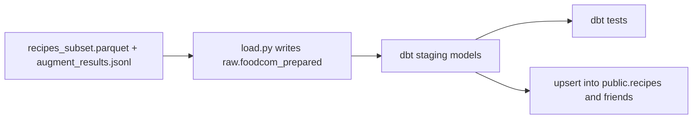
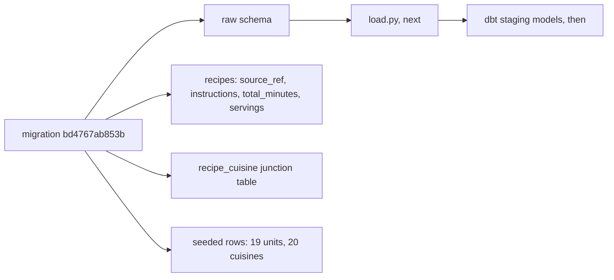
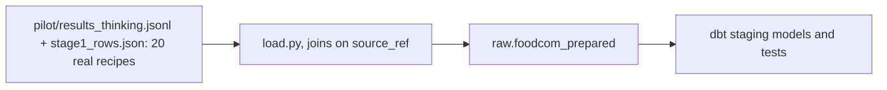

# Week of 10.28 to 11.04: dbt staging for Food.com (Paul)

## Summary
Started stage 3 of the Food.com pipeline: loading the cleaned and LLM-augmented recipes into Supabase with dbt. So far we checked what the live database is missing, and added dbt as a dependency in its own group. The migration, the loader and the dbt models come next.

## PRs this week
| PR | What it did | State |
|---|---|---|
| (pending) `feat/dbt-staging` | dbt dependency, then migration, `load.py`, staging models | Not pushed yet. Branched from `feat/foodcom-augment` (PR #18), so it also shows #17 and #18 until they merge |

## Session: 2026-10-29
### What we worked on and why
Andrew's stages 1 and 2 produce a cleaned recipe file and a file of LLM answers (units, quantities, cuisines). Stage 3 gets that data into Supabase. The path is: write the prepared data into a `raw` schema, let dbt build clean staging tables from it, test them, then upsert into the Alembic-owned `public` tables (DECISIONS #24).

Before writing anything we checked the real database instead of assuming. Connecting to the Supabase session pooler showed:
- Alembic is at `fe3310413886`, so both migrations are applied.
- Only the `public` schema exists. There is no `raw` schema.
- `recipes` has zero rows and only two columns, `recipe_id` and `recipe_name`.
- There is no `recipe_cuisine` table, so a recipe's cuisines have nowhere to go.

So the order is: migration, then `load.py` into `raw`, then dbt. dbt only runs SQL inside Postgres, so the data has to be in a table before it can transform anything.

We also found two things not on this laptop yet: the 200-recipe pilot results (`augment_results.jsonl`, which lives on Andrew's machine) and a clear plan for how many recipes fit in the free tier (DECISIONS #25 says the full 212,846 do not).

### Diagram


### Key code
`pyproject.toml`
```toml
transforms = [
    "dbt-core>=1.12.6",
    "dbt-postgres>=1.11.0",
]
```
`dbt-core` is the engine that compiles our SQL models and runs the tests. `dbt-postgres` is the adapter that knows how to talk to Postgres. It goes in its own `transforms` group, like `pipelines`, because the API Docker image installs with `--no-dev` and never needs dbt. Added with `uv add --group transforms dbt-core dbt-postgres`, which also updated `uv.lock`.

Committed on its own (`Add dbt-core and dbt-postgres in a transforms group`) so a reviewer can see the dependency change separately from the code that uses it.

### Decisions and concepts
- DECISIONS #15 (dbt for SQL transforms) already accepts dbt. A new entry for the `transforms` group is still to write (#27, Proposed), together with the choices below.
- CONCEPTS: a `dbt` entry is still to write, in the same PR as the first model.
- Open choices for the migration: seed `cuisines` and `units` in the migration or in dbt, and create the `raw` schema in Alembic or in dbt.

## Session: 2026-10-30
### What we worked on and why
Wrote the migration that gets Supabase ready for the Food.com load: `alembic/versions/bd4767ab853b_add_raw_schema_recipe_source_columns_.py`. It chains onto `fe3310413886` through `down_revision`, because the first two revisions are already applied and an applied file is never edited. We built it in four jobs, one at a time, and checked each before the next. It is **not applied yet**; we printed the SQL with `alembic upgrade fe3310413886:bd4767ab853b --sql` first, which needs no database connection.

### Where dbt is used (and where it isn't)
This migration does not use dbt. The split of tools is:
- **Alembic** builds the shelves (schemas, tables, columns). It runs once per change.
- **`load.py`** (next) writes the cleaned recipes joined with the LLM answers into `raw.foodcom_prepared`.
- **dbt** turns that one wide table into tidy staging tables (one row per recipe, per ingredient, per cuisine) and runs data tests on them (unique `source_ref`, only allowed units and cuisines).
- The final upsert into `public` is probably a small SQL or Python step, because dbt builds tables but does not do `INSERT ... ON CONFLICT` cleanly. To settle in the dbt PR.

`raw.foodcom_prepared` is not the untouched source. It is the cleaned subset plus the LLM output, so it can be rebuilt by rerunning `load.py` from `recipes_subset.parquet` and `augment_results.jsonl` (DECISIONS #24 amends #14).

### Key code
`alembic/versions/bd4767ab853b_...py`
```python
op.execute("CREATE SCHEMA IF NOT EXISTS raw")
op.add_column("recipes", sa.Column("source_ref", sa.BigInteger))
op.create_unique_constraint("uq_recipes_source_ref", "recipes", ["source_ref"])
```
`raw` is the folder where `load.py` writes. `source_ref` is the Food.com id, and the unique constraint is what lets a later `INSERT ... ON CONFLICT (source_ref)` update a recipe instead of duplicating it on a rerun (idempotency, DECISIONS #14). `add_column` does not make a column unique by itself, so the constraint is a separate call.

All four new columns are nullable, including `source_ref`. The table is empty today, so nothing forces this, but user-saved recipes share the table and have no Food.com id, steps or times. Postgres allows many `NULL`s under a unique constraint. `total_minutes` and `servings` are `Integer` and not `Text`; `instructions` is `Text`, which has no length limit and is no slower than `VARCHAR(n)` in Postgres.

```python
units = sa.table("units", sa.column("unit_name", sa.Text))
op.bulk_insert(units, [{"unit_name": name} for name in UNITS])
```
Seeds the 19 units (and, the same way, the 20 cuisines). These are the closed lists the LLM may answer with (DECISIONS #26), so every answer has an id to map to. Two things that went wrong in the first draft:
- `bulk_insert` takes a table object, not a string name.
- We first hardcoded `unit_id` values. The id column is an identity column, so Postgres would not know those ids were used, and the first unit added later would collide. We pass only the name.

`UNITS` and `CUISINES` are **copied** into the migration instead of imported from `pipelines/foodcom/augment.py`. A migration is a snapshot of what was done on one day. If it imported the lists, a later edit to `augment.py` would change what the same migration does on a fresh database, and the import would also need the `pipelines` dependency group, which Alembic does not install. The cost is two lists to keep in step; a test that compares them is a good follow-up.

```python
def downgrade() -> None:
    # delete seeded rows, drop recipe_cuisine, drop constraint and columns
    op.execute("DROP SCHEMA IF EXISTS raw CASCADE")
```
`downgrade()` undoes everything in reverse order, so an upgrade followed by a rollback leaves the database as it started. It deletes only the seeded names, not every row in `units` and `cuisines`. `CASCADE` is needed once `raw` holds `foodcom_prepared`, because a plain `DROP SCHEMA` fails on a non-empty schema. It is safe here because `raw` is downstream of the paid LLM calls: the paid output is in `augment_results.jsonl`, and the table is rebuilt by rerunning `load.py`. The real risk is losing that jsonl file (it is only on Andrew's laptop), which is a backup problem and not a migration problem.

### When to use downgrade
- To undo a migration you applied locally that had a mistake: roll back, fix the file, apply again. Test with `uv run alembic downgrade -1`, then `upgrade head`.
- To switch to a branch with different migrations.
- Not on production data: a downgrade deletes the columns and the data in them. On production a forward-fixing migration is usually safer.
- `uv run alembic current` shows which revision a database is on.

### Diagram


### Decisions and concepts
- Decided: the `raw` schema and the lookup seeds go in Alembic, not dbt, because `load.py` runs before dbt and Alembic already owns those tables.
- Open (not decided here): real ingredient-name normalization ("boneless skinless chicken breasts" to "chicken breast"). `clean.py` fixes the file's quirks; normalization is a modeling choice that will keep changing, so it belongs with dbt/the `ingredients` table, but it may not fit plain SQL. dbt only does `lower(trim(name))` for now. Roadmap row "Ingredient name normalization v1" has no owner.
- To write in this PR: DECISIONS #27 (Proposed) for the `transforms` group and the choices above, and CONCEPTS entries for dbt, seed (lookup) data, and identity columns.
- CONCEPTS (existing): [Database migration (Alembic)](../docs/CONCEPTS.md#database-migration-alembic), [Junction table](../docs/CONCEPTS.md#junction-table), [Deterministic vs idempotent pipelines](../docs/CONCEPTS.md#deterministic-vs-idempotent-pipelines)

## Session: 2026-10-31
### What we worked on and why
Andrew updated PR #18 after Paul's review, so we checked what changed and whether it affects the migration, then rebased our branch onto it. The plan for the rest of the day is to not wait for #17 and #18 to merge: build against data that is already committed.

### What changed in PR #18 and what it means for us
| Change in #18 | Effect on `feat/dbt-staging` |
|---|---|
| Cuisines grew from 20 to 90, at most 2 per recipe (DECISIONS #26 amendment) | The migration still seeds the old 20. The cuisine seeds wait for the final list; units are unchanged (19) |
| New `extra_ingredients`: items the model finds in the steps that the ingredient list lacks | `recipe_ingredient` needs a flag to tell them apart (DATA_MODEL.md proposes `is_extra`), and stage 3 must normalize extras the same way as listed ones |
| Saved results are keyed by `source_ref`, not `recipe_key` (raised in review) | `load.py` joins on `source_ref`. `recipe_key` is a position number that stage 1 can shift, so it must not be a join key. This matches the unique column we already added |
| Thinking vs no-thinking still open | Only affects the paid full run, not our work |

### Key idea: rebase
A branch is a chain of commits. `git rebase feat/foodcom-augment` replays our two commits on top of Andrew's latest commit, so the history is one straight line (his commits, then ours) and a reviewer of our PR sees only our work. Our commit ids changed (`09f2bc6` to `88b220f`, `42dca71` to `610b53d`) because an id depends on the parent commit.
- Alternative: `git merge`, which keeps history as it happened and adds a merge commit. Safer, noisier.
- Rule: never rebase commits others already have, because it rewrites their ids and forces a `git push --force`. Safe here because the branch was local only.
- If it goes wrong: `git rebase --abort`. If `uv.lock` conflicts, rerun `uv lock` instead of merging it by hand.
- Result: clean rebase, no conflicts, `uv run pytest` gives 79 passed.

### Working without waiting on #18
Andrew committed real data in the new format under `pipelines/foodcom/pilot/`: `results_thinking.jsonl` (20 model answers with extras, cuisines and `source_ref`) and `stage1_rows.json` (the 20 matching cleaned recipes). That is enough to build and test `load.py` and the dbt models end to end. Only three things really wait on Andrew: the final cuisine list, the thinking verdict and budget, and any further change to his output format. To keep the later rebase onto `main` clean, we do not edit his files (`augment.py`, `clean.py`, his docs entries) and copy any list we need.

Plan for the session, in order:
1. Split the migration: schema now, seeds in a later revision. Add `recipe_ingredient.is_extra`.
2. Apply the schema migration to Supabase and verify.
3. Seed the 19 units now; cuisines in a later revision once the list is final.
4. `load.py`: join the results and the cleaned recipes on `source_ref`, write `raw.foodcom_prepared`, test on the 20 pilot recipes.
5. dbt project, connection and `sources.yml`.
6. Staging models: `stg_recipes`, `stg_recipe_ingredients` (listed plus extras), `stg_recipe_cuisines`.
7. dbt tests: unique and not-null `source_ref`, `accepted_values` for units and cuisines, relationships.
8. Decide how the final upsert into `public` runs.
9. DECISIONS #27, CONCEPTS entries, ROADMAP rows.

Two PRs: A is the migration plus `load.py`, B is dbt.



### Step 1 done: the migration split and `is_extra`
We edited `bd4767ab853b` (still unapplied, so editing is allowed) instead of adding a second file yet:
- **Removed** the `CUISINES` list, the cuisine insert and its `downgrade()` delete. The cuisine list is still changing (90 labels in #18, open in DECISIONS #26), and a seed baked into an applied migration can't be edited. A later revision seeds the final list. A comment in the file says so.
- **Kept** the 19 units seed, since that list is unchanged.
- **Added** `recipe_ingredient.is_extra`.
- Fixed the docstring (`recipe_cuisine` now says 1 or 2 cuisines, matching `MAX_CUISINES = 2`).

`alembic/versions/bd4767ab853b_...py`
```python
op.add_column(
    "recipe_ingredient",
    sa.Column("is_extra", sa.Boolean, nullable=False, server_default=sa.false()),
)
```
`is_extra` marks ingredients the LLM found in the steps that Food.com's list lacks (for example oil). The pantry check needs to know which rows are listed and which were inferred, because inferred ones are less certain. `NOT NULL DEFAULT false` is the truthful default: every existing row, and every user-saved recipe, is a listed ingredient, and a three-valued boolean (true, false, null) would force every query to handle null. Tradeoff: a flag column is cheaper than a separate table, but it mixes two kinds of row in one table, so any query that must not count extras has to filter on it.

**What `is_extra` means, with a real row.** Food.com's ingredient list is often incomplete (about 75% of recipes have more quantities than names). Andrew's step has the model read the steps and add items the list lacks. Both kinds become rows in `recipe_ingredient`, and `is_extra` tells them apart because a listed ingredient came from the recipe author (reliable) while an extra was inferred by a model (usually right, sometimes invented). Real example from `pipelines/foodcom/pilot/results_thinking.jsonl`, `source_ref` 47403, "Black Pepper Pork with Ramen Noodles". The source list has five items and no noodles, although the title and the steps ("cook noodles in 2 qts boiling water") use them:

| Ingredient | Amount | `is_extra` | Where it came from |
|---|---|---|---|
| boneless pork chop | 1 lb | false | Food.com list |
| garlic | 2 clove | false | Food.com list |
| onion | 1 piece | false | Food.com list |
| broccoli florets | 2 cup | false | Food.com list |
| black pepper | to taste | false | Food.com list |
| ramen noodles | 1 package | **true** | model, from the steps |
| vegetable oil | 2 tbsp | **true** | model, from the steps |
| stir-fry sauce | 2 tbsp | **true** | model, from the steps (steps say "Stir-Fry Sauce") |
| sesame oil | to taste | **true** | model, from the steps |

The app can then show "also needs vegetable oil" without a plan depending on it, and a query that must not count inferred items can use `WHERE NOT is_extra`. The cost is that any such query has to remember the filter.

Checked without touching the database: `alembic upgrade fe3310413886:bd4767ab853b --sql` and the matching `downgrade --sql` both print the expected statements, and `ruff` passes. Not applied to Supabase yet. Applying changes the live database, so Paul runs `uv run alembic upgrade head` after reading the SQL.

### Applied to Supabase (Paul ran `uv run alembic upgrade head`)
No errors. Verified with read-only queries against the live database:

| Check | Result |
|---|---|
| `alembic_version` | `bd4767ab853b` |
| `raw` schema | exists |
| `recipes` columns | `source_ref` bigint, `instructions` text, `total_minutes` integer, `servings` integer, all nullable |
| `uq_recipes_source_ref` | exists |
| `recipe_ingredient.is_extra` | boolean, `NOT NULL`, default `false` |
| `recipe_cuisine` | exists |
| `units` / `cuisines` rows | 19 / 0 (cuisines wait for the final list) |

Because this revision is now applied, it is frozen: any change goes in a new revision (the cuisine seeds will be one).

### Decisions and concepts
- Process decision: build against the committed pilot data instead of waiting for #18 to merge.
- Decided: `is_extra` is `NOT NULL DEFAULT false` (see above).
- DATA_MODEL.md still says the flag is "proposed, not created yet"; update it in the PR that applies this migration.
- CONCEPTS (to write in this PR): rebase vs merge, join on a stable key (`source_ref` vs a position number).
## What we'd explain differently next time
- The word "raw" is misleading here. It suggests untouched source data, but our `raw` holds prepared data (cleaned recipes plus LLM answers). Read DECISIONS #24 before assuming otherwise.
- Why the migration copies the lists instead of importing them, and why hardcoded ids break an identity column. Both were first-draft mistakes worth remembering.
- We first read `DATABASE_URL` as empty. The check only printed the variable name, not its value, and `.env.example` really is empty, which made the mistake look right. When you check a secret, check its length or shape without printing it.
- dbt does not load data. It only transforms what is already in Postgres, so a loader has to exist first.
