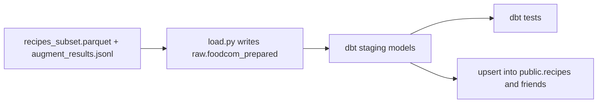
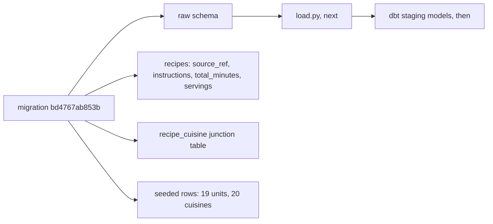

# Week of 10.28 to 11.04: dbt staging for Food.com (Paul)

## Summary
Started stage 3 of the Food.com pipeline: loading the cleaned and LLM-augmented recipes into Supabase with dbt. So far we checked what the live database is missing, and added dbt as a dependency in its own group. The migration, the loader and the dbt models come next.

## PRs this week
| PR | What it did | State |
|---|---|---|
| (pending) `feat/dbt-staging` | dbt dependency, then migration, `load.py`, staging models | Not pushed yet. Branched from `feat/foodcom-augment` (PR #18), so it also shows #17 and #18 until they merge |

## Session: 2026-10-29
### What we worked on and why
Andrew's stages 1 and 2 produce a cleaned recipe file and a file of LLM answers (units, quantities, cuisines). Stage 3 gets that data into Supabase. The path is: write the prepared data into a `raw` schema, let dbt build clean staging tables from it, test them, then upsert into the Alembic-owned `public` tables (DECISIONS #24).

Before writing anything we checked the real database instead of assuming. Connecting to the Supabase session pooler showed:
- Alembic is at `fe3310413886`, so both migrations are applied.
- Only the `public` schema exists. There is no `raw` schema.
- `recipes` has zero rows and only two columns, `recipe_id` and `recipe_name`.
- There is no `recipe_cuisine` table, so a recipe's cuisines have nowhere to go.

So the order is: migration, then `load.py` into `raw`, then dbt. dbt only runs SQL inside Postgres, so the data has to be in a table before it can transform anything.

We also found two things not on this laptop yet: the 200-recipe pilot results (`augment_results.jsonl`, which lives on Andrew's machine) and a clear plan for how many recipes fit in the free tier (DECISIONS #25 says the full 212,846 do not).

### Diagram


### Key code
`pyproject.toml`
```toml
transforms = [
    "dbt-core>=1.12.6",
    "dbt-postgres>=1.11.0",
]
```
`dbt-core` is the engine that compiles our SQL models and runs the tests. `dbt-postgres` is the adapter that knows how to talk to Postgres. It goes in its own `transforms` group, like `pipelines`, because the API Docker image installs with `--no-dev` and never needs dbt. Added with `uv add --group transforms dbt-core dbt-postgres`, which also updated `uv.lock`.

Committed on its own (`Add dbt-core and dbt-postgres in a transforms group`) so a reviewer can see the dependency change separately from the code that uses it.

### Decisions and concepts
- DECISIONS #15 (dbt for SQL transforms) already accepts dbt. A new entry for the `transforms` group is still to write (#27, Proposed), together with the choices below.
- CONCEPTS: a `dbt` entry is still to write, in the same PR as the first model.
- Open choices for the migration: seed `cuisines` and `units` in the migration or in dbt, and create the `raw` schema in Alembic or in dbt.

## Session: 2026-10-30
### What we worked on and why
Wrote the migration that gets Supabase ready for the Food.com load: `alembic/versions/bd4767ab853b_add_raw_schema_recipe_source_columns_.py`. It chains onto `fe3310413886` through `down_revision`, because the first two revisions are already applied and an applied file is never edited. We built it in four jobs, one at a time, and checked each before the next. It is **not applied yet**; we printed the SQL with `alembic upgrade fe3310413886:bd4767ab853b --sql` first, which needs no database connection.

### Where dbt is used (and where it isn't)
This migration does not use dbt. The split of tools is:
- **Alembic** builds the shelves (schemas, tables, columns). It runs once per change.
- **`load.py`** (next) writes the cleaned recipes joined with the LLM answers into `raw.foodcom_prepared`.
- **dbt** turns that one wide table into tidy staging tables (one row per recipe, per ingredient, per cuisine) and runs data tests on them (unique `source_ref`, only allowed units and cuisines).
- The final upsert into `public` is probably a small SQL or Python step, because dbt builds tables but does not do `INSERT ... ON CONFLICT` cleanly. To settle in the dbt PR.

`raw.foodcom_prepared` is not the untouched source. It is the cleaned subset plus the LLM output, so it can be rebuilt by rerunning `load.py` from `recipes_subset.parquet` and `augment_results.jsonl` (DECISIONS #24 amends #14).

### Key code
`alembic/versions/bd4767ab853b_...py`
```python
op.execute("CREATE SCHEMA IF NOT EXISTS raw")
op.add_column("recipes", sa.Column("source_ref", sa.BigInteger))
op.create_unique_constraint("uq_recipes_source_ref", "recipes", ["source_ref"])
```
`raw` is the folder where `load.py` writes. `source_ref` is the Food.com id, and the unique constraint is what lets a later `INSERT ... ON CONFLICT (source_ref)` update a recipe instead of duplicating it on a rerun (idempotency, DECISIONS #14). `add_column` does not make a column unique by itself, so the constraint is a separate call.

All four new columns are nullable, including `source_ref`. The table is empty today, so nothing forces this, but user-saved recipes share the table and have no Food.com id, steps or times. Postgres allows many `NULL`s under a unique constraint. `total_minutes` and `servings` are `Integer` and not `Text`; `instructions` is `Text`, which has no length limit and is no slower than `VARCHAR(n)` in Postgres.

```python
units = sa.table("units", sa.column("unit_name", sa.Text))
op.bulk_insert(units, [{"unit_name": name} for name in UNITS])
```
Seeds the 19 units (and, the same way, the 20 cuisines). These are the closed lists the LLM may answer with (DECISIONS #26), so every answer has an id to map to. Two things that went wrong in the first draft:
- `bulk_insert` takes a table object, not a string name.
- We first hardcoded `unit_id` values. The id column is an identity column, so Postgres would not know those ids were used, and the first unit added later would collide. We pass only the name.

`UNITS` and `CUISINES` are **copied** into the migration instead of imported from `pipelines/foodcom/augment.py`. A migration is a snapshot of what was done on one day. If it imported the lists, a later edit to `augment.py` would change what the same migration does on a fresh database, and the import would also need the `pipelines` dependency group, which Alembic does not install. The cost is two lists to keep in step; a test that compares them is a good follow-up.

```python
def downgrade() -> None:
    # delete seeded rows, drop recipe_cuisine, drop constraint and columns
    op.execute("DROP SCHEMA IF EXISTS raw CASCADE")
```
`downgrade()` undoes everything in reverse order, so an upgrade followed by a rollback leaves the database as it started. It deletes only the seeded names, not every row in `units` and `cuisines`. `CASCADE` is needed once `raw` holds `foodcom_prepared`, because a plain `DROP SCHEMA` fails on a non-empty schema. It is safe here because `raw` is downstream of the paid LLM calls: the paid output is in `augment_results.jsonl`, and the table is rebuilt by rerunning `load.py`. The real risk is losing that jsonl file (it is only on Andrew's laptop), which is a backup problem and not a migration problem.

### When to use downgrade
- To undo a migration you applied locally that had a mistake: roll back, fix the file, apply again. Test with `uv run alembic downgrade -1`, then `upgrade head`.
- To switch to a branch with different migrations.
- Not on production data: a downgrade deletes the columns and the data in them. On production a forward-fixing migration is usually safer.
- `uv run alembic current` shows which revision a database is on.

### Diagram


### Decisions and concepts
- Decided: the `raw` schema and the lookup seeds go in Alembic, not dbt, because `load.py` runs before dbt and Alembic already owns those tables.
- Open (not decided here): real ingredient-name normalization ("boneless skinless chicken breasts" to "chicken breast"). `clean.py` fixes the file's quirks; normalization is a modeling choice that will keep changing, so it belongs with dbt/the `ingredients` table, but it may not fit plain SQL. dbt only does `lower(trim(name))` for now. Roadmap row "Ingredient name normalization v1" has no owner.
- To write in this PR: DECISIONS #27 (Proposed) for the `transforms` group and the choices above, and CONCEPTS entries for dbt, seed (lookup) data, and identity columns.
- CONCEPTS (existing): [Database migration (Alembic)](../docs/CONCEPTS.md#database-migration-alembic), [Junction table](../docs/CONCEPTS.md#junction-table), [Deterministic vs idempotent pipelines](../docs/CONCEPTS.md#deterministic-vs-idempotent-pipelines)

## What we'd explain differently next time
- The word "raw" is misleading here. It suggests untouched source data, but our `raw` holds prepared data (cleaned recipes plus LLM answers). Read DECISIONS #24 before assuming otherwise.
- Why the migration copies the lists instead of importing them, and why hardcoded ids break an identity column. Both were first-draft mistakes worth remembering.
- We first read `DATABASE_URL` as empty. The check only printed the variable name, not its value, and `.env.example` really is empty, which made the mistake look right. When you check a secret, check its length or shape without printing it.
- dbt does not load data. It only transforms what is already in Postgres, so a loader has to exist first.
