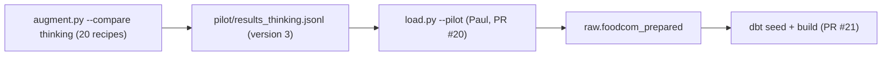

# Week of 11.04 to 11.11: Reviewing the dbt PRs and a version-3 pilot of 20 recipes (Andrew)

## Summary
Paul fixed the schema drift I found in his stage 3 PRs, so I reviewed his dbt models and approved #21. To give him real version-3 data to test the loader and dbt on, I reran the same 20 recipes under the new rules and put the results in a small PR. I also counted what a rating filter would cost us in recipes, with no decision yet.

## PRs this week
| PR | What it did | State |
|---|---|---|
| [#20](https://github.com/andrewtclim/meal-prep-app/pull/20) | Paul's: `raw` schema migration, `load.py`, DECISIONS #27. He applied the six fixes from my review | Open |
| [#21](https://github.com/andrewtclim/meal-prep-app/pull/21) | Paul's: dbt project, staging and intermediate models. I approved it with one test suggestion and two nits | Open, approved |
| [#22](https://github.com/andrewtclim/meal-prep-app/pull/22) | Paul's: `publish.py`, the upsert into `public`. Not reviewed yet | Open |
| [#23](https://github.com/andrewtclim/meal-prep-app/pull/23) | The version-3 pilot results for the 20 recipes, the v2 file renamed, a README section | Open |

## Session: 2026-11-04
### What we worked on and why
Half of Food.com has no rating, so I asked what a rating filter would cost us. `REQUIRE_RATING` in `pipelines/foodcom/clean.py` is `False` today. Numbers are on the 212,846-recipe subset that goes to the LLM:

| Filter | Kept | Lost |
|---|---|---|
| none (today) | 212,846 | 0 |
| has any rating | 116,079 | 96,767 (45.5%) |
| rating at least 4 | 109,517 | 103,329 (48.5%) |
| rated and at least 3 reviews | 50,877 | 161,969 (76.1%) |

Most of the loss is the recipes with no rating at all, and "no rating" means nobody reviewed it, not that it is bad. Among rated recipes only about 1,500 are below 3. Dropping just those would cost 0.7% of the subset. The cutoff itself barely matters; the review count is the harsh filter, because one 5-star review makes a 5.0. LLM cost should scale about in proportion to recipe count. This is a product call for Paul and me, so nothing changed.

## Session: 2026-11-05
### What we worked on and why
Paul rebased #20 and #21 onto the merged #18 and fixed the drift. His reply said the committed pilot file was still version 2, so `load.py --pilot` would skip all 20 rows. I reviewed #21, then reran the 20 recipes so he can load them into Supabase.

### Key code
Command, run from a fresh branch off `main`:
```bash
git mv pipelines/foodcom/pilot/results_thinking.jsonl pipelines/foodcom/pilot/results_thinking_v2.jsonl
uv run --env-file .env --group pipelines python -m pipelines.foodcom.augment --compare thinking
```
`--compare` writes to `results_<mode>.jsonl` and resume only counts records at the current `SCHEMA_VERSION`, so running it on the old file would have appended 20 new lines after the 20 old ones. Renaming the version-2 file first keeps the evidence Paul reviewed and gives his `load.py --pilot` (which reads `results_thinking.jsonl`) a clean version-3 file. The notebook builds its path as `results_{mode}.jsonl`, so its thinking run now points at `thinking_v2`; otherwise it would have compared version-3 thinking against version-2 no-thinking.

The position join in Paul's `dbt/models/intermediate/int_recipe_ingredients.sql` (#21), the part I checked most carefully:
```sql
cross join lateral jsonb_array_elements_text(r.ingredient_parts)
    with ordinality as n(name, idx)       -- idx counts from 1
...
where (item ->> 'position')::int = n.position   -- position = idx - 1
```
It zips the ingredient names with the model's entries on position. That is only right if both count from 0, and they do: `augment.py` numbers names with `enumerate(parts)` and rejects any answer whose positions are not `0..n-1` in order. I also checked that none of the 212,846 recipes has a blank name in `ingredient_parts`, which would shift every later position.

### Diagram


### Results
| Check | Result |
|---|---|
| Valid answers | 20 of 20, no retries, cost $0.0146 |
| Records | all `schema_version` 3, one `cuisine` string each |
| Paul's loader | `load.py --dry-run` on the new file: 20 usable results, 20 rows, database not touched |
| Ingredients vs version 2 | both are thinking mode on the same 20 recipes, only the rules changed; 34 of 170 entries differ in unit or quantity (20%), within the roughly one-third that two identical runs differ by (from an earlier 5-recipe test) |
| Cuisine vs version 2 | the first cuisine changed on 4 of 20 recipes |

The new cuisines are reasonable and not blocking; a real miss would be something like labeling sushi as italian. Two are worth a mention: Cherokee Casserole (keyword `Native American`) became `american` although `native_american` is available and more specific, and Lemon Cucumbers (no cuisine signal) became `american` although the prompt says not to default to it. It is 20 recipes with one run each, so it may be noise. A prompt change would mean a new `SCHEMA_VERSION`, so it is only noted for the team meeting.

### Decisions and concepts
- No new DECISIONS entry. Open for the meeting: the unit list (`can`, `bunch`, `pinch`, `dash`, `piece`), whether to filter on rating, the two small cuisine differences, and how the final upsert into `public` runs (Paul's #22 proposes one).
- CONCEPTS: [Schema drift (and version stamps)](../docs/CONCEPTS.md#schema-drift-and-version-stamps)

## What we'd explain differently next time
My checkout had untracked files (a Neo4j `.env.example`) that clashed with the `.env.example` tracked on `main`, so switching branches would have failed or forced me to move my own work aside. A `git worktree` gives the new branch its own folder and leaves the old checkout untouched. The git-ignored `data/` and `.env` are not in a new worktree, so I linked them in and told git to ignore the links so they could not be committed by accident.
