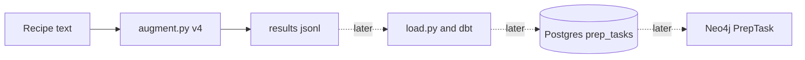

# Week of 11.11 to 11.18: Prep task extraction in the augment step (Andrew)

## Summary
The Food.com augment step now also returns the prep each recipe needs (dice the onion, marinate the chicken) and whether each ingredient is raw or cooked in the finished dish. Prep tasks are what let the app say "dice the onion once for two recipes", so this is the first piece of the core feature (DECISIONS #6) that runs on real recipe text. A 20-recipe pilot showed the data is the hard part: Food.com steps rarely say to chop an onion, so we allowed implied tasks and now have to measure how far to trust them.

## PRs this week
| PR | What it did | State |
|---|---|---|
| [#25](https://github.com/andrewtclim/meal-prep-app/pull/25) | Prep tasks and `state` in `augment.py` (schema version 4), tests, review notebook, docs | Open |

## Session: 2026-11-15
### What we worked on and why
The graph already has a `PrepTask` node (`technique`, `form`) and a query for tasks shared by 2 or more recipes (PR #24), but nothing produced those tasks from recipes. We added the extraction to `augment.py`, next to units and cuisines, because the model is already reading the steps.

The design was agreed before coding:
- **Closed lists** for technique, cut size and state, like units, so tasks match across recipes on exact strings.
- **Positions, not names**, for the ingredient and for a marinade's inputs. A marinade is identified by what is in it (`with`), not by a free-text name, so "soy sauce + garlic" in two recipes is one task.
- **`source_step`** points at the step that states the task. It is evidence for review, not a prep order.

A toy recipe, Soy-Ginger Chicken Bowls, shows the shape. Ingredients: 0 chicken thighs, 1 soy sauce, 2 garlic, 3 ginger, 4 onion, 5 tomatoes, 6 rice, 7 scallions, plus one extra the model found, 8 sesame oil.

| ingredient | technique | cut_size | with | make_ahead | source_step |
|---|---|---|---|---|---|
| onion | dice | small ("finely") | none | true | 1 |
| garlic | mince | null | none | true | 2 |
| ginger | mince | null | none | true | 2 |
| chicken | marinate | null | ginger, garlic, sesame oil, soy sauce | true | 2 |
| tomatoes | dice | null | none | **false** | 4 |

Not tasks: "sear the chicken" (cooking), "slice it" (work on cooked food), and the scallions (no step cuts them). Tomatoes are `raw` in the finished dish and the dice is not made ahead (it goes soggy), but the scheduler still needs it on the cooking night.

The first pilot found a problem. With "only what the steps state", 16 of 20 recipes came back with no tasks at all. Reading them, the steps say "saute onion and garlic" and never "chop". So we added a second kind of task, `stated: false`, where a step uses a fresh vegetable or herb in a way that needs cutting. Those use a default technique (garlic mince, onion dice, herbs chop), never a size, and are never given to meat, fish, canned food or anything used whole.

### Key code
`pipelines/foodcom/augment.py`, the schema for one task:
```python
"prep_tasks": {"type": "array", "items": {"type": "object", "properties": {
    "ingredient": {"type": "integer"},                    # a position, extras numbered after the listed ones
    "technique":  {"type": "string", "enum": TECHNIQUES},
    "cut_size":   {"anyOf": [{"type": "string", "enum": CUT_SIZES}, {"type": "null"}]},
    "with":       {"type": "array", "items": {"type": "integer"}},
    "make_ahead": {"type": "boolean"},
    "source_step": {"type": "integer"},
    "stated":     {"type": "boolean"}, ...
```
The schema makes the API refuse any technique or size that is not on our lists, so the validator never sees "diced" or "finely". `cut_size` uses `anyOf` because the first attempt, a type list with `null` inside an enum, was rejected by the API on all 20 requests (free, but it cost a rerun).

`pipelines/foodcom/augment.py`, what the schema cannot check:
```python
if technique in INPUT_TECHNIQUES and not inputs:
    problems.append(f"{label}: {technique} needs a non-empty `with`")
if t.get("stated") is False:
    if technique not in IMPLIED_TECHNIQUES:   # mince, dice, chop only
        problems.append(f"{label}: an implied task (stated=false) can only use ...")
```
The schema checks each field alone. These rules check links between fields and the recipe (a position that exists, a marinade needs inputs, an implied task never invents a marinade). Problems are returned, not raised, so the single retry can quote them to the model.

`build_user_message`, the steps are now numbered from 1:
```python
"Instructions:\n" + "\n".join(f"Step {i}: {step}" for i, step in enumerate(steps, 1))
```
`source_step` needs something to point at. The "Step" label keeps step numbers (from 1) apart from ingredient positions (from 0).

### Diagram

Solid arrows exist now. Dotted arrows are the follow-ups: `load.py` still skips version-4 records.

### Pilot result
| | v3 | v4 strict | v4 with implied |
|---|---|---|---|
| Valid on first try | 20 of 20 | 20 of 20 | 20 of 20 |
| Tokens in / out per recipe | 2,810 / 894 | 4,078 / 1,183 | 4,460 / 1,506 |
| Cost for the 20 | $0.0146 | $0.0200 | $0.0240 |
| Recipes with a task / tasks | n/a | 4 / 5 | 18 / 50 |

With implied tasks there were 7 groups shared by 2 or more recipes (onion dice in 8 of 20). 41 of the 50 tasks are implied, so the hand review (the version-4 notebook, later replaced by `pilot/prep_tasks_v5.ipynb`) decides how far to trust them. Two things the data told us: `garlic` and `garlic cloves` do not match across recipes (normalization is still to do), and the model skipped a stated task ("sprinkle grated cheese"), so not every miss is the data's fault.

### Decisions and concepts
- DECISIONS #30: prep-task extraction in augment (schema version 4). Proposed.
- CONCEPTS: [Grounded extraction (evidence pointer)](../docs/CONCEPTS.md#grounded-extraction-evidence-pointer), and the validator and nullable-enum notes added to [Structured outputs and closed vocabularies](../docs/CONCEPTS.md#structured-outputs-and-closed-vocabularies).

## What we'd explain differently next time
- The schema checks one field at a time and the validator checks relationships. It is easy to ask the schema for something it cannot do (such as "this position must exist in this recipe").
- `ingredient` is a position in this recipe's list, not an `ingredient_id` from the database. dbt maps it later through `source_ref` and position.
- "Mostly a data problem" was only partly true: coverage was low because the steps are terse, but the grated-cheese miss is the model's.
